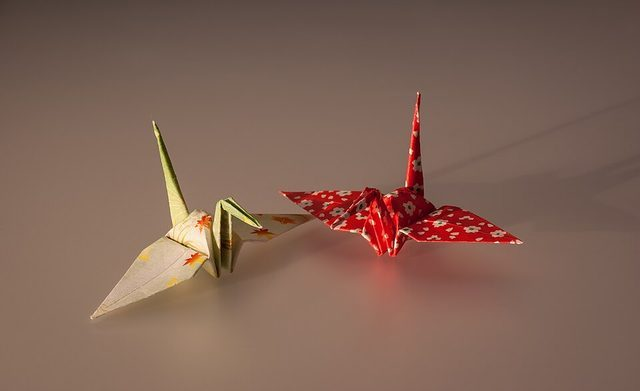

# Origami

*Also known as: Modular origami*

**Encyclopedia ID 3332** (permanent) · https://bpupadhyaya.github.io/world-heritage-games-site/games/3332-origami/

*Photo: Laitche, [Public domain](https://creativecommons.org/publicdomain/mark/1.0/), [source on Wikimedia Commons](https://commons.wikimedia.org/wiki/File:Cranes_made_by_Origami_paper.jpg)*

Real, curling, layered paper in 3D. Grab a flap, drag it across and feel the crease snap flat, then watch your kite, puppy, fish or paper dart stand up.

## How it is played

Each model is a short list of folds. The caption tells you the next one. Grab the glowing corner and drag it across the dashed crease to the ring. Let go past halfway and it lands flat; let go early and it springs back.

## Heritage note

Part of the living heritage of Japan.

## Origins

A living tradition passed from person to person; it is not tied to a single dated origin. It belongs to the cultural world of Japan and Korea.

## Facts

- **Where:** Japan
- **Type:** Crafts and making
- **Family:** Paper, ink and painting crafts
- **Era:** [Living Traditions](../../eras/living/index.md)
- **Cradle:** [Japan and Korea](../../cradles/japan-korea/index.md)
- **Region:** East and Southeast Asia

## Play it

[Try a 90-second preview in your browser](https://bpupadhyaya.github.io/games-site/games/origami-fold-by-fold/play/) · [Google Play](https://play.google.com/store/apps/details?id=com.equalinformation.arcforge.shell) · [App Store](https://apps.apple.com/us/app/arcforge-world-heritage-games/id6813746442)

## Related entries

- [Temari Thread-Ball Patterns](../../games/96-temari-thread-ball-patterns/index.md)
- [Kumiko lattice](../../games/97-kumiko-lattice/index.md)
- [Shibori Indigo Fold](../../games/106-shibori-indigo-fold/index.md)
- [Kumihimo Braid Disk](../../games/107-kumihimo-braid-disk/index.md)
- [Kokeshi doll painting](../../games/355-kokeshi-doll-painting/index.md)
- [Paper Plane Flight Contest](../../games/466-paper-plane-flight-contest/index.md)

## Sources

- <https://en.wikipedia.org/wiki/Origami>
- <https://en.wikipedia.org/wiki/Modular_origami>
