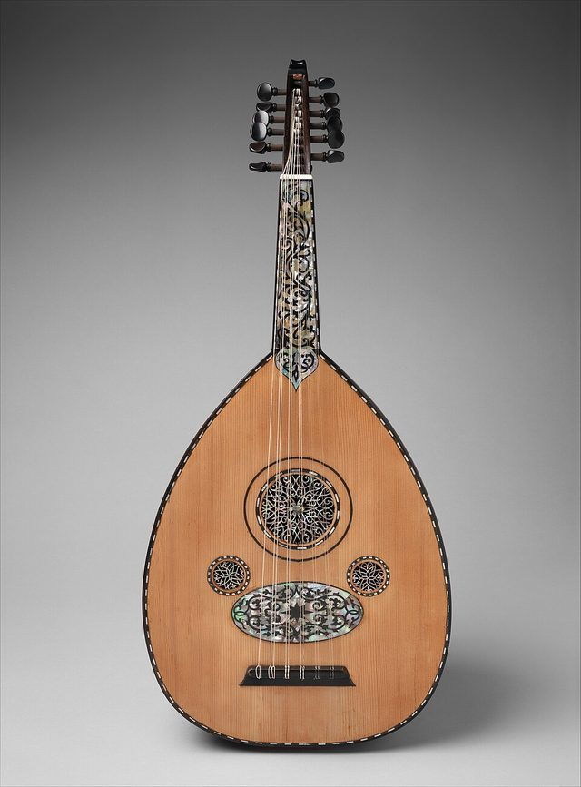

# Oud

**Encyclopedia ID 3348** (permanent) · https://bpupadhyaya.github.io/world-heritage-games-site/games/3348-oud/

*Photo: Creator:Manol (Emmanuel Venios), [CC0](https://creativecommons.org/publicdomain/zero/1.0/), [source on Wikimedia Commons](https://commons.wikimedia.org/wiki/File:%C5%AAd_MET_DP340079.jpg)*

Play the oud, the fretless pear-shaped lute of the Arab world. Slide a finger along the bare neck to land on the right pitch, including the quarter-tones of Rast and Bayati, and pluck in time over rhythm cycles.

## How it is played

Rings on the neck show where each note is. Keep your finger down and slide to bend the note or land on a second ring.

## Heritage note

A tradition shared by communities in many places.

## Origins

Usually placed in the era of Crossroads and Golden Ages (about 500 to 1500), although its exact origins are uncertain.

## Facts

- **Where:** Iraq, Egypt, Syria
- **Type:** Musical instruments
- **Family:** String instruments
- **Era:** [Crossroads and Golden Ages](../../eras/crossroads/index.md) (uncertain)
- **Cradle:** [Shared across the world](../../cradles/worldwide/index.md)
- **Region:** Middle East and North Africa

## Play it

[Try a 90-second preview in your browser](https://bpupadhyaya.github.io/games-site/games/oud-maqam-strings/play/) · [Google Play](https://play.google.com/store/apps/details?id=com.equalinformation.arcforge.shell) · [App Store](https://apps.apple.com/us/app/arcforge-world-heritage-games/id6813746442)

## Related entries

- [Panduri](../../games/41-panduri/index.md)
- [Dombra](../../games/48-dombra/index.md)
- [Charango](../../games/55-charango/index.md)
- [Balalaika](../../games/133-balalaika/index.md)
- [Erhu Two-String Fiddle](../../games/139-erhu-two-string-fiddle/index.md)
- [Buzuq Long-Neck Lute](../../games/218-buzuq-long-neck-lute/index.md)

## Sources

- <https://en.wikipedia.org/wiki/Oud>
