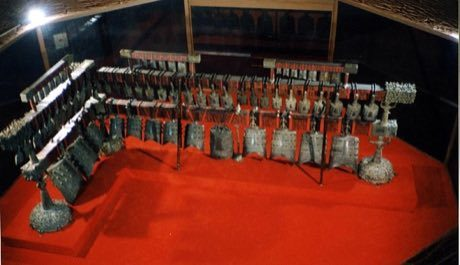

# Bianzhong

*编钟 · bronze chime bells*

**Encyclopedia ID 336** (permanent) · https://equalinformation.com/world-heritage-games-site/games/336-bianzhong/

*Photo: The original uploader was Zzjgbc at Chinese Wikipedia., [CC BY-SA 3.0](https://creativecommons.org/licenses/by-sa/3.0/), [source on Wikimedia Commons](https://commons.wikimedia.org/wiki/File:Bianzhong.jpg)*

Strike a tiered set of bronze bells with mallets, each bell giving two pitches depending on where it is hit, to play melodies.

## Heritage note

Part of the living heritage of China. Some forms of this practice carry deep meaning for the communities who keep it; here we describe the play and the craft only, with respect for its roots.

## Origins

A living tradition passed from person to person; it is not tied to a single dated origin. It belongs to the cultural world of China.

## Facts

- **Where:** China
- **Type:** Musical instruments
- **Family:** Drums and percussion
- **Era:** [Living Traditions](../../eras/living/index.md)
- **Cradle:** [China](../../cradles/china/index.md)
- **Region:** East and Southeast Asia

## Related entries

- [Talking drum](../../games/33-talking-drum/index.md)
- [Marimba](../../games/52-marimba/index.md)
- [Calabash Water Drum](../../games/180-calabash-water-drum/index.md)
- [Amadinda and embaire](../../games/185-amadinda-and-embaire/index.md)
- [Tombak goblet drum rhythms](../../games/233-tombak-goblet-drum-rhythms/index.md)
- [Dhol drum rhythm](../../games/263-dhol-drum-rhythm/index.md)

## Sources

- <https://commons.wikimedia.org/wiki/File:Bianzhong.jpg>
