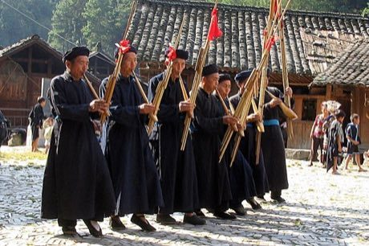

# Lusheng

*芦笙 · Miao and Dong reed-pipe ensemble*

**Encyclopedia ID 337** (permanent) · https://bpupadhyaya.github.io/world-heritage-games-site/games/337-lusheng/

*Photo: Michael Mooney from Chicago, USA, [CC BY 2.0](https://creativecommons.org/licenses/by/2.0/), [source on Wikimedia Commons](https://commons.wikimedia.org/wiki/File:Miao_musicians.jpg)*

Blow and finger a bundle of bamboo pipes in a group, matching your note and a stepping rhythm with other players in a circle.

## Heritage note

A tradition shared by communities in many places. Some forms of this practice carry deep meaning for the communities who keep it; here we describe the play and the craft only, with respect for its roots.

## Origins

A living tradition passed from person to person; it is not tied to a single dated origin.

## Facts

- **Where:** Shared across many places
- **Type:** Musical instruments
- **Family:** Wind instruments
- **Era:** [Living Traditions](../../eras/living/index.md)
- **Cradle:** [Shared across the world](../../cradles/worldwide/index.md)
- **Region:** East and Southeast Asia

## Related entries

- [Khene](../../games/145-khene/index.md)
- [Mijwiz Double Clarinet](../../games/221-mijwiz-double-clarinet/index.md)
- [Mudhif reed-arch house](../../games/230-mudhif-reed-arch-house/index.md)
- [Launeddas Triple Pipe](../../games/400-launeddas-triple-pipe/index.md)
- [Rubboard zydeco rhythm](../../games/437-rubboard-zydeco-rhythm/index.md)
- [Cuneiform Clay Tablet Scribe](../../games/1260-cuneiform-clay-tablet-scribe/index.md)

## Sources

- <https://commons.wikimedia.org/wiki/File:Miao_musicians.jpg>
