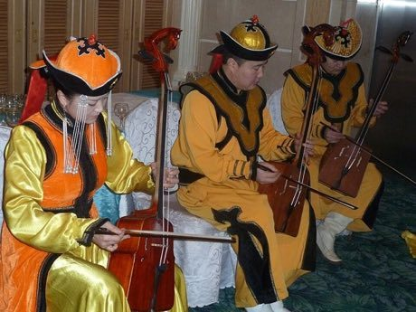

# Morin khuur

*Морин хуур / morin khuur · horsehead fiddle*

**Encyclopedia ID 34** (permanent) · https://equalinformation.com/world-heritage-games-site/games/34-morin-khuur/

*Photo: Antonrood, [CC BY-SA 4.0](https://creativecommons.org/licenses/by-sa/4.0/), [source on Wikimedia Commons](https://commons.wikimedia.org/wiki/File:Morin_khuur_Mongoli%C3%AB.JPG)*

Bow the two strings in time with guiding notes to play steppe melodies and galloping horse rhythms, with the instrument's horse-head scroll and long-song phrasing.

## Heritage note

Part of the living heritage of Mongolia. Some forms of this practice carry deep meaning for the communities who keep it; here we describe the play and the craft only, with respect for its roots. Animals are partners in this tradition; good care and local rules always come first.

## Origins

Usually placed in the era of Classical Worlds (about 1000 BCE to 500 CE), although its exact origins are uncertain, within the cultural world of Steppe and Arctic.

## Facts

- **Where:** Mongolia
- **Type:** Musical instruments
- **Family:** String instruments
- **Era:** [Classical Worlds](../../eras/classical/index.md) (uncertain)
- **Cradle:** [Steppe and Arctic](../../cradles/steppe-arctic/index.md)
- **Region:** East and Southeast Asia

## Related entries

- [Khomus](../../games/379-khomus/index.md)
- [Kathputli string puppets](../../games/79-kathputli-string-puppets/index.md)
- [Valiha tube zither](../../games/124-valiha-tube-zither/index.md)
- [Krar lyre](../../games/126-krar-lyre/index.md)
- [Joropo llanero band](../../games/130-joropo-llanero-band/index.md)
- [Kanklės](../../games/136-kankles/index.md)

## Sources

- <https://commons.wikimedia.org/wiki/File:Morin_khuur_Mongoli%C3%AB.JPG>
