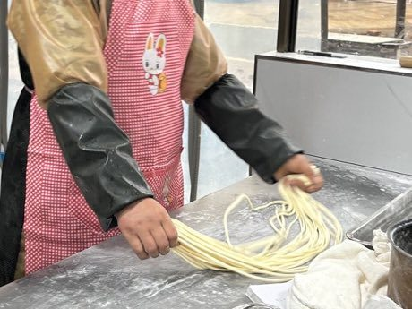

# Lamian

*拉面 · hand-pulled noodles*

**Encyclopedia ID 340** (permanent) · https://bpupadhyaya.github.io/world-heritage-games-site/games/340-lamian/

*Photo: MNXANL, [CC BY-SA 4.0](https://creativecommons.org/licenses/by-sa/4.0/), [source on Wikimedia Commons](https://commons.wikimedia.org/wiki/File:202403_Hand-Pulling_Noodles_of_Yafan,_Jinhua.jpg)*

Stretch, fold and slap dough in a rhythmic pull-and-fold gesture, doubling strands each time to reach target thinness without breaking.

## Heritage note

Part of the living heritage of China.

## Origins

A living tradition passed from person to person; it is not tied to a single dated origin. It belongs to the cultural world of China.

## Facts

- **Where:** China
- **Type:** Crafts and making
- **Era:** [Living Traditions](../../eras/living/index.md)
- **Cradle:** [China](../../cradles/china/index.md)
- **Region:** East and Southeast Asia

## Related entries

- [Chinese knotting](../../games/26-chinese-knotting/index.md)
- [Tanghua](../../games/64-tanghua/index.md)
- [Chuiwan](../../games/332-chuiwan/index.md)
- [Bianzhong](../../games/336-bianzhong/index.md)
- [Seal carving](../../games/341-seal-carving/index.md)
- [Cloisonne](../../games/343-cloisonne/index.md)

## Sources

- <https://commons.wikimedia.org/wiki/File:202403_Hand-Pulling_Noodles_of_Yafan,_Jinhua.jpg>
