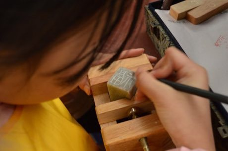

# Seal carving

*篆刻 · zhuanke*

**Encyclopedia ID 341** (permanent) · https://equalinformation.com/world-heritage-games-site/games/341-seal-carving/

*Photo: Cyclohexane233, [CC BY-SA 4.0](https://creativecommons.org/licenses/by-sa/4.0/), [source on Wikimedia Commons](https://commons.wikimedia.org/wiki/File:2018%E8%BF%8E%E6%96%B0%E6%98%A5%E5%BF%97%E6%84%BF%E6%9C%8D%E5%8A%A1%E6%B4%BB%E5%8A%A8_%E7%AF%86%E5%88%BB_03.jpg)*

Plan the characters inside a square, then carve the stone with a knife so the stamped print reveals a balanced design, with scoring for composition and clean strokes.

## Heritage note

Part of the living heritage of China.

## Origins

A living tradition passed from person to person; it is not tied to a single dated origin. It belongs to the cultural world of China.

## Facts

- **Where:** China
- **Type:** Crafts and making
- **Family:** Pottery, wood and metal crafts
- **Era:** [Living Traditions](../../eras/living/index.md)
- **Cradle:** [China](../../cradles/china/index.md)
- **Region:** East and Southeast Asia

## Related entries

- [Zellij tile mosaic](../../games/21-zellij-tile-mosaic/index.md)
- [Swahili carved door](../../games/90-swahili-carved-door/index.md)
- [Thai fruit and vegetable carving](../../games/114-thai-fruit-and-vegetable-carving/index.md)
- [Glassblowing](../../games/121-glassblowing/index.md)
- [Azulejo tile painting](../../games/122-azulejo-tile-painting/index.md)
- [Krobo Powder-Glass Beads](../../games/173-krobo-powder-glass-beads/index.md)

## Sources

- <https://commons.wikimedia.org/wiki/File:2018%E8%BF%8E%E6%96%B0%E6%98%A5%E5%BF%97%E6%84%BF%E6%9C%8D%E5%8A%A1%E6%B4%BB%E5%8A%A8_%E7%AF%86%E5%88%BB_03.jpg>
