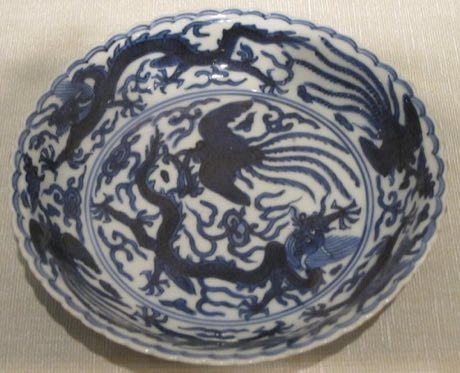

# Blue-and-white porcelain painting

*青花瓷*

**Encyclopedia ID 342** (permanent) · https://equalinformation.com/world-heritage-games-site/games/342-blue-and-white-porcelain-painting/

*Photo: Hiart, [CC0](https://creativecommons.org/publicdomain/zero/1.0/), [source on Wikimedia Commons](https://commons.wikimedia.org/wiki/File:Chinese_dish,_Ming_dynasty,_Wanli_period_(1573-1619),_porcelain_with_glaze,_Honolulu_Academy_of_Arts.JPG)*

Brush cobalt patterns onto a spinning white porcelain piece, balancing line weight and symmetry so the 'firing' reveals the final blue glaze.

## Heritage note

A tradition shared by communities in many places.

## Origins

A living tradition passed from person to person; it is not tied to a single dated origin.

## Facts

- **Where:** Shared across many places
- **Type:** Crafts and making
- **Family:** Paper, ink and painting crafts
- **Era:** [Living Traditions](../../eras/living/index.md)
- **Cradle:** [Shared across the world](../../cradles/worldwide/index.md)
- **Region:** Worldwide

## Related entries

- [Ebru paper marbling](../../games/20-ebru-paper-marbling/index.md)
- [Ndebele geometric wall painting](../../games/23-ndebele-geometric-wall-painting/index.md)
- [Chinese knotting](../../games/26-chinese-knotting/index.md)
- [Matryoshka](../../games/28-matryoshka/index.md)
- [Bogolan mud cloth](../../games/86-bogolan-mud-cloth/index.md)
- [Zulu beadwork letters](../../games/88-zulu-beadwork-letters/index.md)

## Sources

- <https://commons.wikimedia.org/wiki/File:Chinese_dish,_Ming_dynasty,_Wanli_period_(1573-1619),_porcelain_with_glaze,_Honolulu_Academy_of_Arts.JPG>
