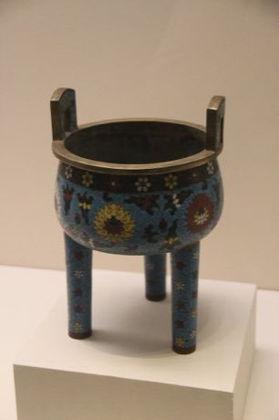

# Cloisonne

*Also known as: 景泰蓝 · Jingtailan enamel*

**Encyclopedia ID 343** (permanent) · https://bpupadhyaya.github.io/world-heritage-games-site/games/343-cloisonne/

*Photo: Gary Todd, [CC0](https://creativecommons.org/publicdomain/zero/1.0/), [source on Wikimedia Commons](https://commons.wikimedia.org/wiki/File:Ming_Cloisonne_Ding.jpg)*

Bend thin wire into patterned cells on a metal vessel, fill each cell with the right enamel colour and fire it for a shining finish.

## Heritage note

Part of the living heritage of China. Some forms of this practice carry deep meaning for the communities who keep it; here we describe the play and the craft only, with respect for its roots.

## Origins

A living tradition passed from person to person; it is not tied to a single dated origin. It belongs to the cultural world of China.

## Facts

- **Where:** China
- **Type:** Crafts and making
- **Family:** Paper, ink and painting crafts
- **Era:** [Living Traditions](../../eras/living/index.md)
- **Cradle:** [China](../../cradles/china/index.md)
- **Region:** East and Southeast Asia

## Related entries

- [Chinese knotting](../../games/26-chinese-knotting/index.md)
- [Oil-paper umbrella making](../../games/344-oil-paper-umbrella-making/index.md)
- [Peranakan beaded slippers](../../games/1358-peranakan-beaded-slippers/index.md)
- [Cheongsam Tailor Shop](../../games/1462-cheongsam-tailor-shop/index.md)
- [Chinese paper cutting](../../games/1987-chinese-paper-cutting/index.md)
- [Ebru paper marbling](../../games/20-ebru-paper-marbling/index.md)

## Sources

- <https://commons.wikimedia.org/wiki/File:Ming_Cloisonne_Ding.jpg>
