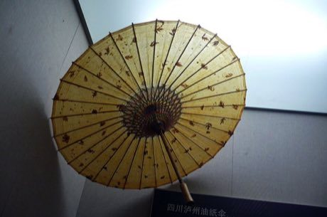

# Oil-paper umbrella making

*油纸伞*

**Encyclopedia ID 344** (permanent) · https://equalinformation.com/world-heritage-games-site/games/344-oil-paper-umbrella-making/

*Photo: 三猎, [CC BY-SA 4.0](https://creativecommons.org/licenses/by-sa/4.0/), [source on Wikimedia Commons](https://commons.wikimedia.org/wiki/File:%E5%9B%9B%E5%B7%9D%E6%B3%B8%E5%B7%9E%E6%B2%B9%E7%BA%B8%E4%BC%9E.jpg)*

Fit bamboo ribs onto the hub, stretch and paste the paper, paint the pattern and oil it, then open the finished umbrella in the rain.

## Heritage note

Part of the living heritage of China.

## Origins

A living tradition passed from person to person; it is not tied to a single dated origin. It belongs to the cultural world of China.

## Facts

- **Where:** China
- **Type:** Crafts and making
- **Family:** Paper, ink and painting crafts
- **Era:** [Living Traditions](../../eras/living/index.md)
- **Cradle:** [China](../../cradles/china/index.md)
- **Region:** East and Southeast Asia

## Related entries

- [Chinese knotting](../../games/26-chinese-knotting/index.md)
- [Cloisonne](../../games/343-cloisonne/index.md)
- [Peranakan beaded slippers](../../games/1358-peranakan-beaded-slippers/index.md)
- [Cheongsam Tailor Shop](../../games/1462-cheongsam-tailor-shop/index.md)
- [Ebru paper marbling](../../games/20-ebru-paper-marbling/index.md)
- [Ndebele geometric wall painting](../../games/23-ndebele-geometric-wall-painting/index.md)

## Sources

- <https://commons.wikimedia.org/wiki/File:%E5%9B%9B%E5%B7%9D%E6%B3%B8%E5%B7%9E%E6%B2%B9%E7%BA%B8%E4%BC%9E.jpg>
