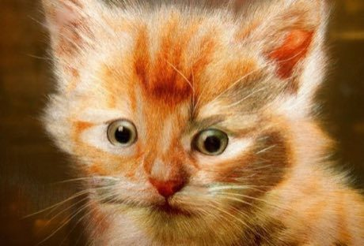

# Suzhou silk embroidery

*苏绣 · Su xiu*

**Encyclopedia ID 345** (permanent) · https://bpupadhyaya.github.io/world-heritage-games-site/games/345-suzhou-silk-embroidery/

*Photo: Cecikierk, [Public domain](https://creativecommons.org/publicdomain/mark/1.0/), [source on Wikimedia Commons](https://commons.wikimedia.org/wiki/File:Suzhou_cat_embroidery.jpg)*

Choose and blend hair-fine silk threads in layered stitches, tracing a guide to build up a photorealistic animal or flower, including double-sided pieces.

## Heritage note

Part of the living heritage of China.

## Origins

A living tradition passed from person to person; it is not tied to a single dated origin. It belongs to the cultural world of China.

## Facts

- **Where:** China
- **Type:** Crafts and making
- **Family:** Textile and weaving crafts
- **Era:** [Living Traditions](../../eras/living/index.md)
- **Cradle:** [China](../../cradles/china/index.md)
- **Region:** East and Southeast Asia

## Related entries

- [Hmong story cloth](../../games/1298-hmong-story-cloth/index.md)
- [Kente strip weaving](../../games/22-kente-strip-weaving/index.md)
- [Celtic knot weave](../../games/25-celtic-knot-weave/index.md)
- [Sashiko Stitch Patterns](../../games/27-sashiko-stitch-patterns/index.md)
- [Adire indigo resist dyeing](../../games/87-adire-indigo-resist-dyeing/index.md)
- [Agaseke basket weaving](../../games/89-agaseke-basket-weaving/index.md)

## Sources

- <https://commons.wikimedia.org/wiki/File:Suzhou_cat_embroidery.jpg>
