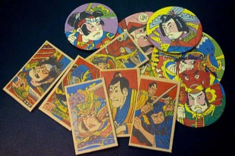

# Menko

*Also known as: 面子 · card and disc slapping*

**Encyclopedia ID 346** (permanent) · https://bpupadhyaya.github.io/world-heritage-games-site/games/346-menko/

*Photo: Nesnad, [CC BY-SA 3.0](https://creativecommons.org/licenses/by-sa/3.0/), [source on Wikimedia Commons](https://commons.wikimedia.org/wiki/File:Menko-square-circle-collection.jpg)*

Each player lays a thick paper card or disc on the floor; the other slams their own down to create a gust or strike that flips it, winning both.

## Heritage note

Part of the living heritage of Japan.

## Origins

Usually placed in the era of Modern Heritage (1800 to today), although its exact origins are uncertain, within the cultural world of Japan and Korea.

## Facts

- **Where:** Japan
- **Type:** Dexterity and skill games
- **Family:** Puzzle and dexterity toys
- **Era:** [Modern Heritage](../../eras/modern/index.md) (uncertain)
- **Cradle:** [Japan and Korea](../../cradles/japan-korea/index.md)
- **Region:** East and Southeast Asia

## Play it

[Try a 90-second preview in your browser](https://bpupadhyaya.github.io/games-site/games/menko/play/) · [Google Play](https://play.google.com/store/apps/details?id=com.equalinformation.arcforge.shell) · App Store (coming soon)

## Related entries

- [Kingyo-sukui](../../games/3-kingyo-sukui/index.md)
- [Secret Puzzle Box](../../games/29-secret-puzzle-box/index.md)
- [Daruma Otoshi](../../games/63-daruma-otoshi/index.md)
- [Kamishibai](../../games/353-kamishibai/index.md)
- [Tatami room tiling puzzle](../../games/356-tatami-room-tiling-puzzle/index.md)
- [Hashi](../../games/360-hashi/index.md)

## Sources

- <https://commons.wikimedia.org/wiki/File:Menko-square-circle-collection.jpg>
