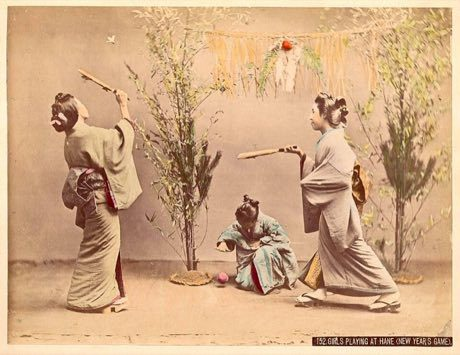

# Hanetsuki

*羽根突き · Japanese battledore*

**Encyclopedia ID 347** (permanent) · https://bpupadhyaya.github.io/world-heritage-games-site/games/347-hanetsuki/

*Photo: Kusakabe Kimbei, [Public domain](https://creativecommons.org/publicdomain/mark/1.0/), [source on Wikimedia Commons](https://commons.wikimedia.org/wiki/File:Kusakabe_Kimbei_-_152_Girls_Playing_at_Hane.jpg)*

Players bat a feathered hane shuttle with decorated wooden paddles (hagoita), one solo keep-up or two-player rally; misses are marked with ink on the face.

## Heritage note

Part of the living heritage of Japan.

## Origins

Usually placed in the era of Age of Contact and Craft (about 1500 to 1800), although its exact origins are uncertain, within the cultural world of Japan and Korea.

## Facts

- **Where:** Japan
- **Type:** Racing
- **Family:** Water sports
- **Era:** [Age of Contact and Craft](../../eras/contact/index.md) (uncertain)
- **Cradle:** [Japan and Korea](../../cradles/japan-korea/index.md)
- **Region:** East and Southeast Asia

## Related entries

- [Nouka Baich](../../games/42-nouka-baich/index.md)
- [Pirogue coastal canoe race](../../games/56-pirogue-coastal-canoe-race/index.md)
- [Nile Felucca Sailing](../../games/216-nile-felucca-sailing/index.md)
- [Shikara paddle race](../../games/265-shikara-paddle-race/index.md)
- [Venetian lagoon regatta](../../games/486-venetian-lagoon-regatta/index.md)
- [Ngalawa outrigger sailing](../../games/1259-ngalawa-outrigger-sailing/index.md)

## Sources

- <https://commons.wikimedia.org/wiki/File:Kusakabe_Kimbei_-_152_Girls_Playing_at_Hane.jpg>
