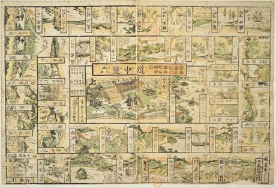

# E-sugoroku

*Also known as: 絵双六 · Picture sugoroku · Sugoroku · Tokaido travel board*

**Encyclopedia ID 348** (permanent) · https://bpupadhyaya.github.io/world-heritage-games-site/games/348-e-sugoroku/

*Photo: Keisai Eisen, [Public domain](https://creativecommons.org/publicdomain/mark/1.0/), [source on Wikimedia Commons](https://commons.wikimedia.org/wiki/File:NDL-DC_1310705-Keisai_Eisen-%E6%9D%B1%E6%B5%B7%E9%81%93%E4%BA%94%E6%8B%BE%E4%B8%89%E9%A7%85%E5%90%8D%E6%89%80%E5%8F%A4%E8%B7%A1%E7%95%A5%E8%A8%98%E9%81%93%E4%B8%AD%E5%8F%8C%E5%85%AD-crd.jpg)*

Roll dice to travel the 53 stations of the old Tokaido road on an illustrated Edo board, landing on stops with events, shortcuts and setbacks.

## Heritage note

Part of the living heritage of Japan.

## Origins

Usually placed in the era of River Valleys and First Cities (about 3000 to 1000 BCE), although its exact origins are uncertain, within the cultural world of Japan and Korea.

## Facts

- **Where:** Japan
- **Type:** Board and table games
- **Family:** Dice and knucklebone games
- **Era:** [River Valleys and First Cities](../../eras/river-valleys/index.md) (uncertain)
- **Cradle:** [Japan and Korea](../../cradles/japan-korea/index.md)
- **Region:** East and Southeast Asia
- **Players:** 2+

## Related entries

- [Yut Nori](../../games/1083-yut-nori/index.md)
- [Sho](../../games/286-sho/index.md)
- [Liubo](../../games/331-liubo/index.md)
- [Generala](../../games/422-generala/index.md)
- [Game of the Goose](../../games/450-game-of-the-goose/index.md)
- [Sáhkku](../../games/451-sahkku/index.md)

## Sources

- <https://commons.wikimedia.org/wiki/File:NDL-DC_1310705-Keisai_Eisen-%E6%9D%B1%E6%B5%B7%E9%81%93%E4%BA%94%E6%8B%BE%E4%B8%89%E9%A7%85%E5%90%8D%E6%89%80%E5%8F%A4%E8%B7%A1%E7%95%A5%E8%A8%98%E9%81%93%E4%B8%AD%E5%8F%8C%E5%85%AD-crd.jpg>
- <https://en.wikipedia.org/wiki/Sugoroku>
