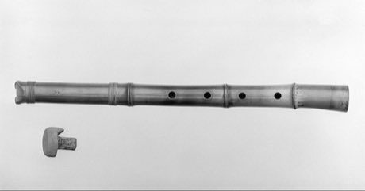

# Shakuhachi

*Also known as: 尺八 · end-blown bamboo flute*

**Encyclopedia ID 349** (permanent) · https://bpupadhyaya.github.io/world-heritage-games-site/games/349-shakuhachi/

*Photo: MET Museum, [CC0](https://creativecommons.org/publicdomain/zero/1.0/), [source on Wikimedia Commons](https://commons.wikimedia.org/wiki/File:Shakuhachi_MET_142073.jpg)*

Players shape breath and angle on a five-hole bamboo flute to play melodies by steady tone and pitch-bend.

## Heritage note

Part of the living heritage of Japan. Some forms of this practice carry deep meaning for the communities who keep it; here we describe the play and the craft only, with respect for its roots.

## Origins

Usually placed in the era of Classical Worlds (about 1000 BCE to 500 CE), although its exact origins are uncertain, within the cultural world of Japan and Korea.

## Facts

- **Where:** Japan
- **Type:** Musical instruments
- **Family:** Wind instruments
- **Era:** [Classical Worlds](../../eras/classical/index.md) (uncertain)
- **Cradle:** [Japan and Korea](../../cradles/japan-korea/index.md)
- **Region:** East and Southeast Asia

## Related entries

- [Dizi](../../games/132-dizi/index.md)
- [Fujara](../../games/135-fujara/index.md)
- [Bansuri bamboo flute](../../games/149-bansuri-bamboo-flute/index.md)
- [Kurai](../../games/1237-kurai/index.md)
- [Khloy bamboo duct flute](../../games/1311-khloy-bamboo-duct-flute/index.md)
- [Koto](../../games/2937-koto/index.md)

## Sources

- <https://commons.wikimedia.org/wiki/File:Shakuhachi_MET_142073.jpg>
