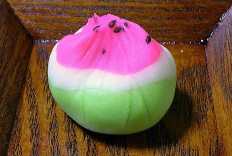

# Nerikiri wagashi sculpting

*練り切り*

**Encyclopedia ID 350** (permanent) · https://bpupadhyaya.github.io/world-heritage-games-site/games/350-nerikiri-wagashi-sculpting/

*Photo: en:Nightshadow28, [CC BY-SA 3.0](https://creativecommons.org/licenses/by-sa/3.0/), [source on Wikimedia Commons](https://commons.wikimedia.org/wiki/File:Nerikiri_(Suika).jpg)*

Shape coloured bean-paste dough into seasonal sweets (flowers, fruit, leaves) using tools, matching a target form for a score.

## Heritage note

Part of the living heritage of Japan.

## Origins

A living tradition passed from person to person; it is not tied to a single dated origin. It belongs to the cultural world of Japan and Korea.

## Facts

- **Where:** Japan
- **Type:** Crafts and making
- **Era:** [Living Traditions](../../eras/living/index.md)
- **Cradle:** [Japan and Korea](../../cradles/japan-korea/index.md)
- **Region:** East and Southeast Asia

## Related entries

- [Sashiko Stitch Patterns](../../games/27-sashiko-stitch-patterns/index.md)
- [Karesansui](../../games/95-karesansui/index.md)
- [Temari Thread-Ball Patterns](../../games/96-temari-thread-ball-patterns/index.md)
- [Kumiko lattice](../../games/97-kumiko-lattice/index.md)
- [Ikebana](../../games/98-ikebana/index.md)
- [Shibori Indigo Fold](../../games/106-shibori-indigo-fold/index.md)

## Sources

- <https://commons.wikimedia.org/wiki/File:Nerikiri_(Suika).jpg>
