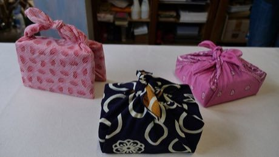

# Furoshiki

*風呂敷 · cloth-wrapping puzzle*

**Encyclopedia ID 351** (permanent) · https://equalinformation.com/world-heritage-games-site/games/351-furoshiki/

*Photo: Culture Japon, [CC BY-SA 4.0](https://creativecommons.org/licenses/by-sa/4.0/), [source on Wikimedia Commons](https://commons.wikimedia.org/wiki/File:Furoshiki,_traditional_japanese_wrapping_technique_with_cloths_(1).jpg)*

Fold and knot a square cloth around objects of different shapes using ordered tucks and knots to match a target wrap.

## Heritage note

Part of the living heritage of Japan.

## Origins

A living tradition passed from person to person; it is not tied to a single dated origin. It belongs to the cultural world of Japan and Korea.

## Facts

- **Where:** Japan
- **Type:** Crafts and making
- **Era:** [Living Traditions](../../eras/living/index.md)
- **Cradle:** [Japan and Korea](../../cradles/japan-korea/index.md)
- **Region:** East and Southeast Asia

## Related entries

- [Sashiko Stitch Patterns](../../games/27-sashiko-stitch-patterns/index.md)
- [Karesansui](../../games/95-karesansui/index.md)
- [Temari Thread-Ball Patterns](../../games/96-temari-thread-ball-patterns/index.md)
- [Kumiko lattice](../../games/97-kumiko-lattice/index.md)
- [Ikebana](../../games/98-ikebana/index.md)
- [Shibori Indigo Fold](../../games/106-shibori-indigo-fold/index.md)

## Sources

- <https://commons.wikimedia.org/wiki/File:Furoshiki,_traditional_japanese_wrapping_technique_with_cloths_(1).jpg>
