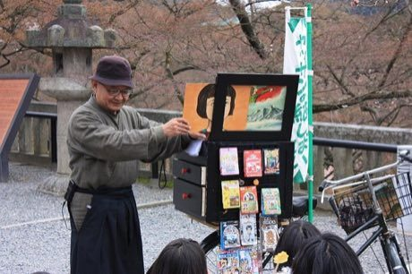

# Kamishibai

*紙芝居 · paper-card storytelling*

**Encyclopedia ID 353** (permanent) · https://bpupadhyaya.github.io/world-heritage-games-site/games/353-kamishibai/

*Photo: Moroboshi, [CC BY-SA 3.0](https://creativecommons.org/licenses/by-sa/3.0/), [source on Wikimedia Commons](https://commons.wikimedia.org/wiki/File:Kamishibai_artist_at_kyomizudera_1.jpg)*

Arrange and pull illustrated cards in a wooden frame in the right order to tell a story and keep the child audience's attention.

## Heritage note

Part of the living heritage of Japan.

## Origins

Usually placed in the era of Modern Heritage (1800 to today), although its exact origins are uncertain, within the cultural world of Japan and Korea.

## Facts

- **Where:** Japan
- **Type:** Puzzles and mind games
- **Family:** Puzzle and dexterity toys
- **Era:** [Modern Heritage](../../eras/modern/index.md) (uncertain)
- **Cradle:** [Japan and Korea](../../cradles/japan-korea/index.md)
- **Region:** East and Southeast Asia

## Related entries

- [Kingyo-sukui](../../games/3-kingyo-sukui/index.md)
- [Daruma Otoshi](../../games/63-daruma-otoshi/index.md)
- [Menko](../../games/346-menko/index.md)
- [Tatami room tiling puzzle](../../games/356-tatami-room-tiling-puzzle/index.md)
- [Hashi](../../games/360-hashi/index.md)
- [Hangul syllable blocks](../../games/364-hangul-syllable-blocks/index.md)

## Sources

- <https://commons.wikimedia.org/wiki/File:Kamishibai_artist_at_kyomizudera_1.jpg>
