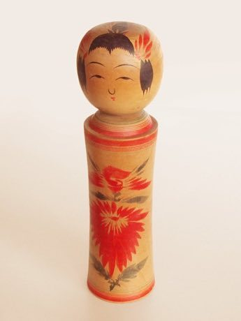

# Kokeshi doll painting

*こけし*

**Encyclopedia ID 355** (permanent) · https://bpupadhyaya.github.io/world-heritage-games-site/games/355-kokeshi-doll-painting/

*Photo: Batholith, [Public domain](https://creativecommons.org/publicdomain/mark/1.0/), [source on Wikimedia Commons](https://commons.wikimedia.org/wiki/File:Kokeshi_20101105.jpg)*

Turn and paint a lathe-shaped wooden doll in the style of regional families (bold stripes, floral motifs, face brush).

## Heritage note

Part of the living heritage of Japan. Some forms of this practice carry deep meaning for the communities who keep it; here we describe the play and the craft only, with respect for its roots.

## Origins

A living tradition passed from person to person; it is not tied to a single dated origin. It belongs to the cultural world of Japan and Korea.

## Facts

- **Where:** Japan
- **Type:** Crafts and making
- **Family:** Paper, ink and painting crafts
- **Era:** [Living Traditions](../../eras/living/index.md)
- **Cradle:** [Japan and Korea](../../cradles/japan-korea/index.md)
- **Region:** East and Southeast Asia

## Related entries

- [Temari Thread-Ball Patterns](../../games/96-temari-thread-ball-patterns/index.md)
- [Kumiko lattice](../../games/97-kumiko-lattice/index.md)
- [Shibori Indigo Fold](../../games/106-shibori-indigo-fold/index.md)
- [Kumihimo Braid Disk](../../games/107-kumihimo-braid-disk/index.md)
- [Paper Plane Flight Contest](../../games/466-paper-plane-flight-contest/index.md)
- [Bojagi](../../games/363-bojagi/index.md)

## Sources

- <https://commons.wikimedia.org/wiki/File:Kokeshi_20101105.jpg>
