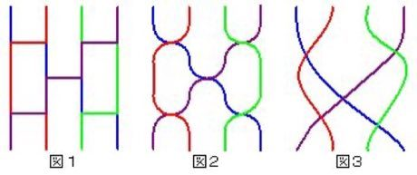

# Amidakuji

*Also known as: あみだくじ · ghost-leg lottery*

**Encyclopedia ID 357** (permanent) · https://bpupadhyaya.github.io/world-heritage-games-site/games/357-amidakuji/

*Photo: Yoimondai on ja.wikipedia, [CC BY-SA 3.0](https://creativecommons.org/licenses/by-sa/3.0/), [source on Wikimedia Commons](https://commons.wikimedia.org/wiki/File:Amidakuji.jpg)*

Pick a top line and follow it down, taking every horizontal rung you meet, to find where you end up (prize, task, or order).

## Heritage note

Part of the living heritage of Japan.

## Origins

Usually placed in the era of Modern Heritage (1800 to today), although its exact origins are uncertain, within the cultural world of Japan and Korea.

## Facts

- **Where:** Japan
- **Type:** Puzzles and mind games
- **Family:** Tops, kites and spinning toys
- **Era:** [Modern Heritage](../../eras/modern/index.md) (uncertain)
- **Cradle:** [Japan and Korea](../../cradles/japan-korea/index.md)
- **Region:** East and Southeast Asia

## Play it

[Web preview](https://bpupadhyaya.github.io/) · [Google Play](https://play.google.com/store/apps/details?id=com.equalinformation.arcforge.shell) · [App Store](https://apps.apple.com/us/app/arcforge-world-heritage-games/id6813746442)

## Related entries

- [Kendama](../../games/850-kendama/index.md)
- [Hoop Rolling Trundle](../../games/69-hoop-rolling-trundle/index.md)
- [Spinning top](../../games/678-spinning-top/index.md)
- [Gasing uri](../../games/1289-gasing-uri/index.md)
- [Yo-yo](../../games/696-yo-yo/index.md)
- [Gasing](../../games/908-gasing/index.md)

## Sources

- <https://commons.wikimedia.org/wiki/File:Amidakuji.jpg>
