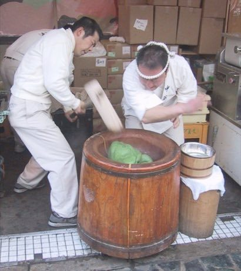

# Mochitsuki

*餅つき · rice pounding rhythm duet*

**Encyclopedia ID 358** (permanent) · https://equalinformation.com/world-heritage-games-site/games/358-mochitsuki/

*Photo: Chris 73, [CC BY-SA 3.0](https://creativecommons.org/licenses/by-sa/3.0/), [source on Wikimedia Commons](https://commons.wikimedia.org/wiki/File:Making_mochi_with_an_Usu_and_Kine.jpg)*

One player pounds steamed rice with a mallet while the partner wets and turns it between strikes; sync the beats to make smooth mochi.

## Heritage note

Part of the living heritage of Japan. Some forms of this practice carry deep meaning for the communities who keep it; here we describe the play and the craft only, with respect for its roots.

## Origins

A living tradition passed from person to person; it is not tied to a single dated origin. It belongs to the cultural world of Japan and Korea.

## Facts

- **Where:** Japan
- **Type:** Performance and storytelling
- **Era:** [Living Traditions](../../eras/living/index.md)
- **Cradle:** [Japan and Korea](../../cradles/japan-korea/index.md)
- **Region:** East and Southeast Asia

## Related entries

- [Sashiko Stitch Patterns](../../games/27-sashiko-stitch-patterns/index.md)
- [Karesansui](../../games/95-karesansui/index.md)
- [Temari Thread-Ball Patterns](../../games/96-temari-thread-ball-patterns/index.md)
- [Kumiko lattice](../../games/97-kumiko-lattice/index.md)
- [Ikebana](../../games/98-ikebana/index.md)
- [Shibori Indigo Fold](../../games/106-shibori-indigo-fold/index.md)

## Sources

- <https://commons.wikimedia.org/wiki/File:Making_mochi_with_an_Usu_and_Kine.jpg>
