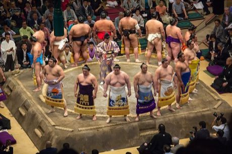

# Sumo bout

*相撲 · ring push-out*

**Encyclopedia ID 359** (permanent) · https://equalinformation.com/world-heritage-games-site/games/359-sumo-bout/

*Photo: Simon Q, [CC BY 2.0](https://creativecommons.org/licenses/by/2.0/), [source on Wikimedia Commons](https://commons.wikimedia.org/wiki/File:Sumo_dohyo-iri_May_2014_001.jpg)*

Two wrestlers push, pivot and slap to force the other out of the straw-edged ring or off balance; short rounds decided in seconds.

## Heritage note

Part of the living heritage of Japan. Some forms of this practice carry deep meaning for the communities who keep it; here we describe the play and the craft only, with respect for its roots.

## Origins

Usually placed in the era of River Valleys and First Cities (about 3000 to 1000 BCE), although its exact origins are uncertain, within the cultural world of Japan and Korea.

## Facts

- **Where:** Japan
- **Type:** Wrestling and martial sports
- **Family:** Wrestling
- **Era:** [River Valleys and First Cities](../../eras/river-valleys/index.md) (uncertain)
- **Cradle:** [Japan and Korea](../../cradles/japan-korea/index.md)
- **Region:** East and Southeast Asia

## Related entries

- [Ssireum](../../games/366-ssireum/index.md)
- [Laamb Wrestling Bout](../../games/166-laamb-wrestling-bout/index.md)
- [Kurash](../../games/253-kurash/index.md)
- [Kushti / Pehlwani mud wrestling](../../games/256-kushti-pehlwani-mud-wrestling/index.md)
- [Bökh](../../games/374-bokh/index.md)
- [Mas-wrestling](../../games/380-mas-wrestling/index.md)

## Sources

- <https://commons.wikimedia.org/wiki/File:Sumo_dohyo-iri_May_2014_001.jpg>
