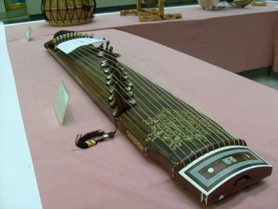

# Gayageum

*Also known as: 가야금 · twelve-string zither*

**Encyclopedia ID 361** (permanent) · https://bpupadhyaya.github.io/world-heritage-games-site/games/361-gayageum/

*Photo: Visviva, [Public domain](https://creativecommons.org/publicdomain/mark/1.0/), [source on Wikimedia Commons](https://commons.wikimedia.org/wiki/File:Gayageum_12_string.jpg)*

Pluck, press and shake (nonghyeon) the twelve silk strings, sliding bridges to tune, to play along with falling note cues that include the bending, vibrato-like gestures that make Korean sanjo music sound the way it...

## How it is played

Pluck, press and shake (nonghyeon) the twelve silk strings, sliding bridges to tune, to play along with falling note cues that include the bending, vibrato-like gestures that make Korean sanjo music sound the way it does.

## Heritage note

Part of the living heritage of South Korea. Some forms of this practice carry deep meaning for the communities who keep it; here we describe the play and the craft only, with respect for its roots.

## Origins

Usually placed in the era of Classical Worlds (about 1000 BCE to 500 CE), although its exact origins are uncertain, within the cultural world of Japan and Korea.

## Facts

- **Where:** South Korea
- **Type:** Musical instruments
- **Family:** String instruments
- **Era:** [Classical Worlds](../../eras/classical/index.md) (uncertain)
- **Cradle:** [Japan and Korea](../../cradles/japan-korea/index.md)
- **Region:** East and Southeast Asia

## Related entries

- [Geomungo](../../games/1453-geomungo/index.md)
- [Koto](../../games/2937-koto/index.md)
- [Morin khuur](../../games/34-morin-khuur/index.md)
- [String Marionette Theatre](../../games/68-string-marionette-theatre/index.md)
- [Kathputli string puppets](../../games/79-kathputli-string-puppets/index.md)
- [Valiha tube zither](../../games/124-valiha-tube-zither/index.md)

## Sources

- <https://commons.wikimedia.org/wiki/File:Gayageum_12_string.jpg>
