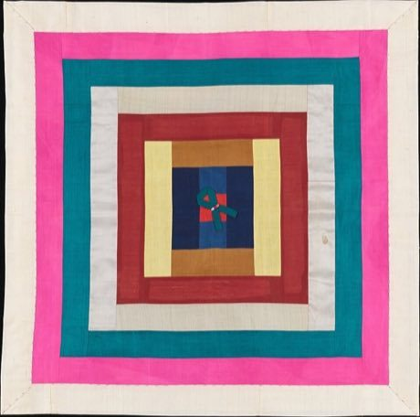

# Bojagi

*보자기 · patchwork wrapping cloth*

**Encyclopedia ID 363** (permanent) · https://equalinformation.com/world-heritage-games-site/games/363-bojagi/

*Photo: Metropolitan Museum of Art, [CC0](https://creativecommons.org/publicdomain/zero/1.0/), [source on Wikimedia Commons](https://commons.wikimedia.org/wiki/File:Patchwork_Bojagi_(Wrapping_Cloth)_MET_DP158238.jpg)*

Pick silk scraps from a tray and sew them seam by seam into a translucent, window-like cloth, matching colour rules and seam allowances to fill a given frame, then fold-wrap an object with it.

## Heritage note

Part of the living heritage of South Korea. Some forms of this practice carry deep meaning for the communities who keep it; here we describe the play and the craft only, with respect for its roots.

## Origins

A living tradition passed from person to person; it is not tied to a single dated origin. It belongs to the cultural world of Japan and Korea.

## Facts

- **Where:** South Korea
- **Type:** Crafts and making
- **Family:** Paper, ink and painting crafts
- **Era:** [Living Traditions](../../eras/living/index.md)
- **Cradle:** [Japan and Korea](../../cradles/japan-korea/index.md)
- **Region:** East and Southeast Asia

## Related entries

- [Maedeup](../../games/1468-maedeup/index.md)
- [Temari Thread-Ball Patterns](../../games/96-temari-thread-ball-patterns/index.md)
- [Kumiko lattice](../../games/97-kumiko-lattice/index.md)
- [Shibori Indigo Fold](../../games/106-shibori-indigo-fold/index.md)
- [Kumihimo Braid Disk](../../games/107-kumihimo-braid-disk/index.md)
- [Kokeshi doll painting](../../games/355-kokeshi-doll-painting/index.md)

## Sources

- <https://commons.wikimedia.org/wiki/File:Patchwork_Bojagi_(Wrapping_Cloth)_MET_DP158238.jpg>
