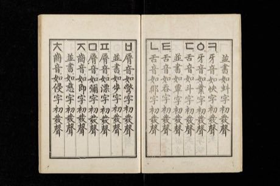

# Hangul syllable blocks

*한글 · letter-block builder*

**Encyclopedia ID 364** (permanent) · https://bpupadhyaya.github.io/world-heritage-games-site/games/364-hangul-syllable-blocks/

*Photo: Government of Joseon, [Public domain](https://creativecommons.org/publicdomain/mark/1.0/), [source on Wikimedia Commons](https://commons.wikimedia.org/wiki/File:Hunminjeongeum_Haerye_03.jpg)*

Drag consonant and vowel pieces into square syllable blocks (Hangul is built from shapes that mimic the mouth), then chain blocks into words that fit a grid or answer a picture.

## Heritage note

Part of the living heritage of South Korea.

## Origins

Usually placed in the era of Modern Heritage (1800 to today), although its exact origins are uncertain, within the cultural world of Japan and Korea.

## Facts

- **Where:** South Korea
- **Type:** Puzzles and mind games
- **Family:** Puzzle and dexterity toys
- **Era:** [Modern Heritage](../../eras/modern/index.md) (uncertain)
- **Cradle:** [Japan and Korea](../../cradles/japan-korea/index.md)
- **Region:** East and Southeast Asia

## Related entries

- [Tuho](../../games/1089-tuho/index.md)
- [Kingyo-sukui](../../games/3-kingyo-sukui/index.md)
- [Daruma Otoshi](../../games/63-daruma-otoshi/index.md)
- [Menko](../../games/346-menko/index.md)
- [Kamishibai](../../games/353-kamishibai/index.md)
- [Tatami room tiling puzzle](../../games/356-tatami-room-tiling-puzzle/index.md)

## Sources

- <https://commons.wikimedia.org/wiki/File:Hunminjeongeum_Haerye_03.jpg>
