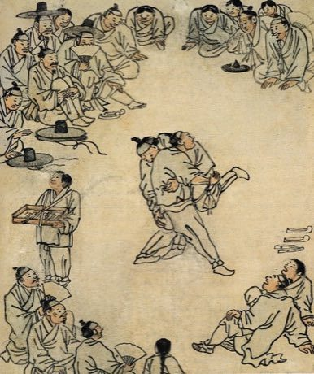

# Ssireum

*Also known as: 씨름 · Korean sash wrestling*

**Encyclopedia ID 366** (permanent) · https://bpupadhyaya.github.io/world-heritage-games-site/games/366-ssireum/

*Photo: Kim Hong-do, [Public domain](https://creativecommons.org/publicdomain/mark/1.0/), [source on Wikimedia Commons](https://commons.wikimedia.org/wiki/File:Danwon-Ssireum.jpg)*

Both players grab the opponent's thigh and waist sash.

## Heritage note

Part of the living heritage of South Korea.

## Origins

Usually placed in the era of River Valleys and First Cities (about 3000 to 1000 BCE), although its exact origins are uncertain, within the cultural world of Japan and Korea.

## Facts

- **Where:** South Korea
- **Type:** Wrestling and martial sports
- **Family:** Wrestling
- **Era:** [River Valleys and First Cities](../../eras/river-valleys/index.md) (uncertain)
- **Cradle:** [Japan and Korea](../../cradles/japan-korea/index.md)
- **Region:** East and Southeast Asia

## Play it

[Web preview](https://bpupadhyaya.github.io/) · [Google Play](https://play.google.com/store/apps/details?id=com.equalinformation.arcforge.shell) · [App Store](https://apps.apple.com/us/app/arcforge-world-heritage-games/id6813746442)

## Related entries

- [Sumo bout](../../games/359-sumo-bout/index.md)
- [Laamb Wrestling Bout](../../games/166-laamb-wrestling-bout/index.md)
- [Kurash](../../games/253-kurash/index.md)
- [Kushti / Pehlwani mud wrestling](../../games/256-kushti-pehlwani-mud-wrestling/index.md)
- [Bökh](../../games/374-bokh/index.md)
- [Mas-wrestling](../../games/380-mas-wrestling/index.md)

## Sources

- <https://commons.wikimedia.org/wiki/File:Danwon-Ssireum.jpg>
