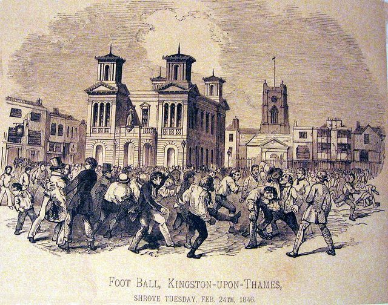

# Rugby football

**Encyclopedia ID 3686** (permanent) · https://bpupadhyaya.github.io/world-heritage-games-site/games/3686-rugby-football/

*Photo: Unknown author Unknown author, [Public domain](https://creativecommons.org/publicdomain/mark/1.0/), [source on Wikimedia Commons](https://commons.wikimedia.org/wiki/File:Foot_Ball,_Kingston-upon-Thames,_Shrove_Tuesday,_Feb._24th,_1846.jpg)*

The goal-kicking game of the conversion kick.

## How it is played

Read the wind dial and the flag on the posts, then aim into the wind. Pick Upright, Leaning or Flat and set the power. Press Kick and watch the three beats of the run-up.

## Heritage note

Part of the living heritage of United Kingdom.

## Origins

Usually placed in the era of Modern Heritage (1800 to today), although its exact origins are uncertain, within the cultural world of Celtic and Atlantic Europe.

## Facts

- **Where:** United Kingdom, New Zealand, South Africa
- **Type:** Team ball sports
- **Family:** Kicking and football games
- **Era:** [Modern Heritage](../../eras/modern/index.md) (uncertain)
- **Cradle:** [Celtic and Atlantic Europe](../../cradles/celtic-atlantic/index.md)
- **Region:** Europe

## Play it

[Try a 90-second preview in your browser](https://bpupadhyaya.github.io/games-site/games/rugby-conversion-kick/play/) · [Google Play](https://play.google.com/store/apps/details?id=com.equalinformation.arcforge.shell) · [App Store](https://apps.apple.com/us/app/arcforge-world-heritage-games/id6813746442)

## Related entries

- [Traditional football](../../games/10068-traditional-football/index.md)
- [Badminton](../../games/22322-badminton/index.md)
- [Jianzi](../../games/1-jianzi/index.md)
- [Nohejbal](../../games/378-nohejbal/index.md)
- [Peteca](../../games/421-peteca/index.md)
- [Sepak takraw](../../games/802-sepak-takraw/index.md)

## Sources

- <https://en.wikipedia.org/wiki/Rugby_football>
