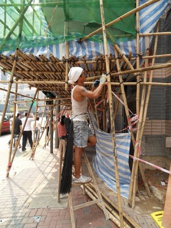

# Bamboo scaffold builder

*Also known as: 棚架 · Hong Kong*

**Encyclopedia ID 369** (permanent) · https://bpupadhyaya.github.io/world-heritage-games-site/games/369-bamboo-scaffold-builder/

*Photo: Clément Bucco-Lechat, [CC BY-SA 3.0](https://creativecommons.org/licenses/by-sa/3.0/), [source on Wikimedia Commons](https://commons.wikimedia.org/wiki/File:Construction_worker_building_a_bamboo_scaffolding_in_Hong_Kong_(1).JPG)*

Lash bamboo poles together with nylon ties following the lift pattern to raise a scaffold against a tower or a pop-up theatre, checking load and sway as it goes up.

## Heritage note

Part of the living heritage of China.

## Origins

A living tradition passed from person to person; it is not tied to a single dated origin. It belongs to the cultural world of China.

## Facts

- **Where:** China
- **Type:** Crafts and making
- **Family:** Winter sports
- **Era:** [Living Traditions](../../eras/living/index.md)
- **Cradle:** [China](../../cradles/china/index.md)
- **Region:** East and Southeast Asia

## Related entries

- [Neon sign bender](../../games/371-neon-sign-bender/index.md)
- [Dumpling Pleating](../../games/499-dumpling-pleating/index.md)
- [Hong Kong Milk Tea Pulling](../../games/1463-hong-kong-milk-tea-pulling/index.md)
- [Plate Spinning](../../games/73-plate-spinning/index.md)
- [Wire car](../../games/85-wire-car/index.md)
- [Maple taffy on snow](../../games/441-maple-taffy-on-snow/index.md)

## Sources

- <https://commons.wikimedia.org/wiki/File:Construction_worker_building_a_bamboo_scaffolding_in_Hong_Kong_(1).JPG>
