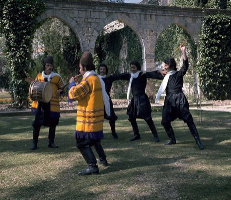

# Dabke line dance

*Dabke / Dabka*

**Encyclopedia ID 37** (permanent) · https://bpupadhyaya.github.io/world-heritage-games-site/games/37-dabke-line-dance/

*Photo: Lebanon Ministry of Tourism, [CC0](https://creativecommons.org/publicdomain/zero/1.0/), [source on Wikimedia Commons](https://commons.wikimedia.org/wiki/File:Lebanese_Dabke_Nasser_Makhoul_Troupe.jpg)*

keep the leader's step pattern on the beat across increasingly complex steps.

## Heritage note

Part of the living heritage of Lebanon.

## Origins

A living tradition passed from person to person; it is not tied to a single dated origin. It belongs to the cultural world of Mesopotamia, Levant and Arabia.

## Facts

- **Where:** Lebanon
- **Type:** Dances
- **Family:** Folk and line dances
- **Era:** [Living Traditions](../../eras/living/index.md)
- **Cradle:** [Mesopotamia, Levant and Arabia](../../cradles/mesopotamia-levant/index.md)
- **Region:** Middle East and North Africa

## Related entries

- [Gumboot dance rhythm](../../games/123-gumboot-dance-rhythm/index.md)
- [Tahtib](../../games/157-tahtib/index.md)
- [Eskista](../../games/188-eskista/index.md)
- [Jebena coffee brewing](../../games/189-jebena-coffee-brewing/index.md)
- [Cueca](../../games/430-cueca/index.md)
- [Faroese chain dance](../../games/1276-faroese-chain-dance/index.md)

## Sources

- <https://commons.wikimedia.org/wiki/File:Lebanese_Dabke_Nasser_Makhoul_Troupe.jpg>
