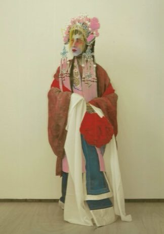

# Cantonese opera role maker

*Also known as: 粵劇*

**Encyclopedia ID 370** (permanent) · https://bpupadhyaya.github.io/world-heritage-games-site/games/370-cantonese-opera-role-maker/

*Photo: Jennychan1968, [CC BY-SA 4.0](https://creativecommons.org/licenses/by-sa/4.0/), [source on Wikimedia Commons](https://commons.wikimedia.org/wiki/File:Hand_coloured_photo_of_a_Cantonese_Opera_Male_Dan_performer_as_Hau_Mulan_in_1927,_Hong_Kong.jpg)*

Choose the headdress, painted-face colours and gestures for a role (scholar, general, lady), then perform a short scene by matching sung rhythm and moves.

## Heritage note

A tradition shared by communities in many places. Some forms of this practice carry deep meaning for the communities who keep it; here we describe the play and the craft only, with respect for its roots.

## Origins

A living tradition passed from person to person; it is not tied to a single dated origin.

## Facts

- **Where:** Shared across many places
- **Type:** Crafts and making
- **Family:** Paper, ink and painting crafts
- **Era:** [Living Traditions](../../eras/living/index.md)
- **Cradle:** [Shared across the world](../../cradles/worldwide/index.md)
- **Region:** East and Southeast Asia

## Related entries

- [Ebru paper marbling](../../games/20-ebru-paper-marbling/index.md)
- [Ndebele geometric wall painting](../../games/23-ndebele-geometric-wall-painting/index.md)
- [Chinese knotting](../../games/26-chinese-knotting/index.md)
- [Matryoshka](../../games/28-matryoshka/index.md)
- [Bogolan mud cloth](../../games/86-bogolan-mud-cloth/index.md)
- [Zulu beadwork letters](../../games/88-zulu-beadwork-letters/index.md)

## Sources

- <https://commons.wikimedia.org/wiki/File:Hand_coloured_photo_of_a_Cantonese_Opera_Male_Dan_performer_as_Hau_Mulan_in_1927,_Hong_Kong.jpg>
