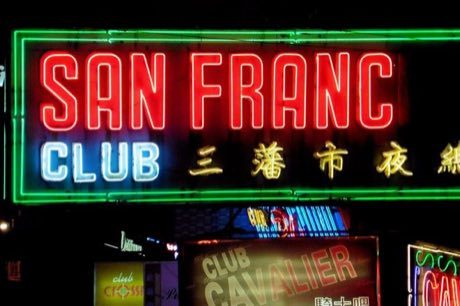

# Neon sign bender

*Also known as: 霓虹燈 · Hong Kong*

**Encyclopedia ID 371** (permanent) · https://bpupadhyaya.github.io/world-heritage-games-site/games/371-neon-sign-bender/

*Photo: Chris from Shenzhen, [CC BY-SA 2.0](https://creativecommons.org/licenses/by-sa/2.0/), [source on Wikimedia Commons](https://commons.wikimedia.org/wiki/File:Neon_Signs_Wan_Chai_Hong_Kong_City_(26009259343).jpg)*

Heat a glass tube and drag the bend line along a template path to shape characters and shop-sign motifs, then wire and light them up on the street.

## Heritage note

Part of the living heritage of China.

## Origins

A living tradition passed from person to person; it is not tied to a single dated origin. It belongs to the cultural world of China.

## Facts

- **Where:** China
- **Type:** Crafts and making
- **Family:** Winter sports
- **Era:** [Living Traditions](../../eras/living/index.md)
- **Cradle:** [China](../../cradles/china/index.md)
- **Region:** East and Southeast Asia

## Related entries

- [Bamboo scaffold builder](../../games/369-bamboo-scaffold-builder/index.md)
- [Dumpling Pleating](../../games/499-dumpling-pleating/index.md)
- [Hong Kong Milk Tea Pulling](../../games/1463-hong-kong-milk-tea-pulling/index.md)
- [Plate Spinning](../../games/73-plate-spinning/index.md)
- [Wire car](../../games/85-wire-car/index.md)
- [Moroccan Mint Tea High Pour](../../games/211-moroccan-mint-tea-high-pour/index.md)

## Sources

- <https://commons.wikimedia.org/wiki/File:Neon_Signs_Wan_Chai_Hong_Kong_City_(26009259343).jpg>
