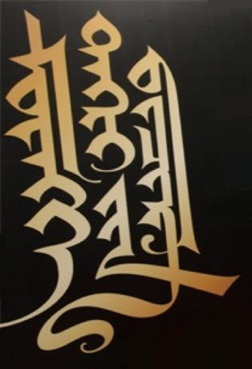

# Mongol bichig

*ᠮᠣᠩᠭᠣᠯ ᠪᠢᠴᠢᠭ · vertical script calligraphy*

**Encyclopedia ID 373** (permanent) · https://equalinformation.com/world-heritage-games-site/games/373-mongol-bichig/

*Photo: Unknown author, [Public domain](https://creativecommons.org/publicdomain/mark/1.0/), [source on Wikimedia Commons](https://commons.wikimedia.org/wiki/File:Modern_Mongol_calligraphy.jpg)*

Draw the top-down strokes of the traditional script with a reed pen following a stroke guide, linking letters into a vertical word whose shape changes by position in the word.

## Heritage note

Part of the living heritage of Mongolia.

## Origins

A living tradition passed from person to person; it is not tied to a single dated origin. It belongs to the cultural world of Steppe and Arctic.

## Facts

- **Where:** Mongolia
- **Type:** Crafts and making
- **Family:** Paper, ink and painting crafts
- **Era:** [Living Traditions](../../eras/living/index.md)
- **Cradle:** [Steppe and Arctic](../../cradles/steppe-arctic/index.md)
- **Region:** East and Southeast Asia

## Related entries

- [Ebru paper marbling](../../games/20-ebru-paper-marbling/index.md)
- [Ndebele geometric wall painting](../../games/23-ndebele-geometric-wall-painting/index.md)
- [Chinese knotting](../../games/26-chinese-knotting/index.md)
- [Matryoshka](../../games/28-matryoshka/index.md)
- [Bogolan mud cloth](../../games/86-bogolan-mud-cloth/index.md)
- [Zulu beadwork letters](../../games/88-zulu-beadwork-letters/index.md)

## Sources

- <https://commons.wikimedia.org/wiki/File:Modern_Mongol_calligraphy.jpg>
