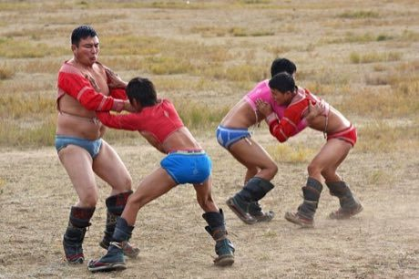

# Bökh

*бөх · Mongolian wrestling*

**Encyclopedia ID 374** (permanent) · https://bpupadhyaya.github.io/world-heritage-games-site/games/374-bokh/

*Photo: Kyle Taylor, [CC BY 2.0](https://creativecommons.org/licenses/by/2.0/), [source on Wikimedia Commons](https://commons.wikimedia.org/wiki/File:Bokh_wrestling_at_the_Terelj_National_Park_(3961462793).jpg)*

Two wrestlers in boots and short jackets grapple.

## Heritage note

Part of the living heritage of Mongolia. Some forms of this practice carry deep meaning for the communities who keep it; here we describe the play and the craft only, with respect for its roots.

## Origins

Usually placed in the era of River Valleys and First Cities (about 3000 to 1000 BCE), although its exact origins are uncertain, within the cultural world of Steppe and Arctic.

## Facts

- **Where:** Mongolia
- **Type:** Wrestling and martial sports
- **Family:** Wrestling
- **Era:** [River Valleys and First Cities](../../eras/river-valleys/index.md) (uncertain)
- **Cradle:** [Steppe and Arctic](../../cradles/steppe-arctic/index.md)
- **Region:** East and Southeast Asia

## Related entries

- [Mas-wrestling](../../games/380-mas-wrestling/index.md)
- [Laamb Wrestling Bout](../../games/166-laamb-wrestling-bout/index.md)
- [Kurash](../../games/253-kurash/index.md)
- [Kushti / Pehlwani mud wrestling](../../games/256-kushti-pehlwani-mud-wrestling/index.md)
- [Sumo bout](../../games/359-sumo-bout/index.md)
- [Ssireum](../../games/366-ssireum/index.md)

## Sources

- <https://commons.wikimedia.org/wiki/File:Bokh_wrestling_at_the_Terelj_National_Park_(3961462793).jpg>
