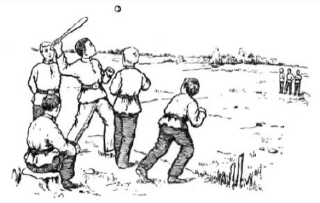

# Lapta

*Also known as: Лапта · Russian bat-and-run*

**Encyclopedia ID 375** (permanent) · https://bpupadhyaya.github.io/world-heritage-games-site/games/375-lapta/

*Photo: М. Волков, [Public domain](https://creativecommons.org/publicdomain/mark/1.0/), [source on Wikimedia Commons](https://commons.wikimedia.org/wiki/File:%D0%98%D0%B3%D1%80%D0%B0_%D0%B2_%D0%BB%D0%B0%D0%BF%D1%82%D1%83_%D0%B2_%D0%A0%D0%BE%D1%81%D1%81%D0%B8%D0%B8.jpg)*

A thrower serves the ball, the batter hits it with a short flat bat and runs to the far line and back before fielders can hit them with the ball.

## Heritage note

Part of the living heritage of Russia.

## Origins

Usually placed in the era of Modern Heritage (1800 to today), although its exact origins are uncertain, within the cultural world of Northern and Eastern Europe.

## Facts

- **Where:** Russia
- **Type:** Street and playground games
- **Family:** Bat-and-ball games
- **Era:** [Modern Heritage](../../eras/modern/index.md) (uncertain)
- **Cradle:** [Northern and Eastern Europe](../../cradles/north-east-europe/index.md)
- **Region:** Europe

## Related entries

- [Pesapallo](../../games/484-pesapallo/index.md)
- [Stoolball](../../games/492-stoolball/index.md)
- [Four Corners](../../games/652-four-corners/index.md)
- [Rounders](../../games/761-rounders/index.md)
- [Gilli-Danda](../../games/793-gilli-danda/index.md)
- [Svaika](../../games/1048-svaika/index.md)

## Sources

- <https://commons.wikimedia.org/wiki/File:%D0%98%D0%B3%D1%80%D0%B0_%D0%B2_%D0%BB%D0%B0%D0%BF%D1%82%D1%83_%D0%B2_%D0%A0%D0%BE%D1%81%D1%81%D0%B8%D0%B8.jpg>
