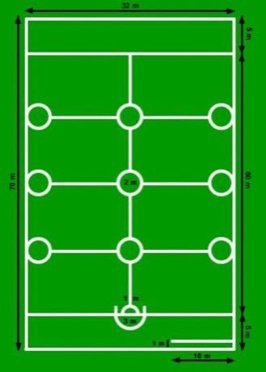

# Oina

**Encyclopedia ID 376** (permanent) · https://bpupadhyaya.github.io/world-heritage-games-site/games/376-oina/

*Photo: Ayceman, [Public domain](https://creativecommons.org/publicdomain/mark/1.0/), [source on Wikimedia Commons](https://commons.wikimedia.org/wiki/File:Oina_Field_Animation.gif)*

Two teams alternate batting and fielding on a long pitch; the batter hits a small ball thrown by a teammate and runs to the far line and back while fielders try to hit the runner.

## Heritage note

Part of the living heritage of Romania.

## Origins

Usually placed in the era of Age of Contact and Craft (about 1500 to 1800), although its exact origins are uncertain, within the cultural world of Northern and Eastern Europe.

## Facts

- **Where:** Romania
- **Type:** Bat-and-ball games
- **Era:** [Age of Contact and Craft](../../eras/contact/index.md) (uncertain)
- **Cradle:** [Northern and Eastern Europe](../../cradles/north-east-europe/index.md)
- **Region:** Europe

## Related entries

- [Gorodki](../../games/13-gorodki/index.md)
- [Finnish pin toss](../../games/49-finnish-pin-toss/index.md)
- [Partner-Carry Obstacle Race](../../games/406-partner-carry-obstacle-race/index.md)
- [Kicksled Race](../../games/407-kicksled-race/index.md)
- [Letter Categories](../../games/472-letter-categories/index.md)
- [Danish pin billiards](../../games/671-danish-pin-billiards/index.md)

## Sources

- <https://commons.wikimedia.org/wiki/File:Oina_Field_Animation.gif>
