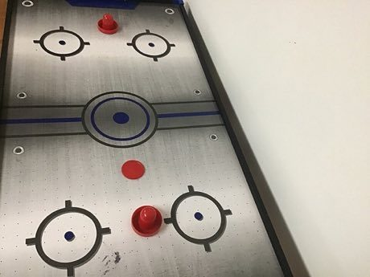

# Cymbergaj

*Cymbergaj · Polish puck table game*

**Encyclopedia ID 377** (permanent) · https://bpupadhyaya.github.io/world-heritage-games-site/games/377-cymbergaj/

*Photo: Severestorm28, [CC BY-SA 4.0](https://creativecommons.org/licenses/by-sa/4.0/), [source on Wikimedia Commons](https://commons.wikimedia.org/wiki/File:Air_hockey_table.jpg)*

Two players slide a puck with hand pushers on a table (air-cushioned in modern form) and try to land it in the opponent's goal; the original used coins flicked with a comb or ruler.

## Heritage note

Part of the living heritage of Poland.

## Origins

Usually placed in the era of Modern Heritage (1800 to today), although its exact origins are uncertain, within the cultural world of Northern and Eastern Europe.

## Facts

- **Where:** Poland
- **Type:** Dexterity and skill games
- **Family:** Winter sports
- **Era:** [Modern Heritage](../../eras/modern/index.md) (uncertain)
- **Cradle:** [Northern and Eastern Europe](../../cradles/north-east-europe/index.md)
- **Region:** Europe

## Related entries

- [Hose-Run Fire Sport](../../games/1281-hose-run-fire-sport/index.md)
- [Varpa](../../games/1396-varpa/index.md)
- [Ice Stock Sport](../../games/1451-ice-stock-sport/index.md)
- [Chinlone](../../games/16-chinlone/index.md)
- [Pinata swing](../../games/61-pinata-swing/index.md)
- [Ring Tilting](../../games/65-ring-tilting/index.md)

## Sources

- <https://commons.wikimedia.org/wiki/File:Air_hockey_table.jpg>
