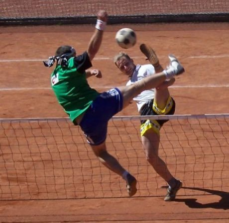

# Nohejbal

*Also known as: foot volleyball*

**Encyclopedia ID 378** (permanent) · https://bpupadhyaya.github.io/world-heritage-games-site/games/378-nohejbal/

*Photo: Misak113, [CC BY-SA 3.0](https://creativecommons.org/licenses/by-sa/3.0/), [source on Wikimedia Commons](https://commons.wikimedia.org/wiki/File:Nohejbal.jpg)*

Teams of 2-3 return a football over a tennis-style net using only feet, head and body, with up to three touches.

## Heritage note

Part of the living heritage of Czechia.

## Origins

Usually placed in the era of Modern Heritage (1800 to today), although its exact origins are uncertain, within the cultural world of Northern and Eastern Europe.

## Facts

- **Where:** Czechia
- **Type:** Team ball sports
- **Family:** Kicking and football games
- **Era:** [Modern Heritage](../../eras/modern/index.md) (uncertain)
- **Cradle:** [Northern and Eastern Europe](../../cradles/north-east-europe/index.md)
- **Region:** Europe

## Related entries

- [Jianzi](../../games/1-jianzi/index.md)
- [Peteca](../../games/421-peteca/index.md)
- [Sepak takraw](../../games/802-sepak-takraw/index.md)
- [Chapteh shuttlecock](../../games/1066-chapteh-shuttlecock/index.md)
- [Traditional football](../../games/10068-traditional-football/index.md)
- [American football](../../games/22320-american-football/index.md)

## Sources

- <https://commons.wikimedia.org/wiki/File:Nohejbal.jpg>
