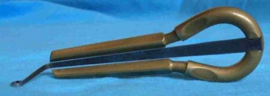

# Khomus

*Хомус · Sakha jaw harp*

**Encyclopedia ID 379** (permanent) · https://bpupadhyaya.github.io/world-heritage-games-site/games/379-khomus/

*Photo: Tosha, [Public domain](https://creativecommons.org/publicdomain/mark/1.0/), [source on Wikimedia Commons](https://commons.wikimedia.org/wiki/File:Kamuz.jpg)*

The player holds the metal harp against the teeth and plucks the tongue while shaping the mouth to bring out overtones, imitating horses, wind and birds.

## Heritage note

Part of the living heritage of Russia.

## Origins

Usually placed in the era of Classical Worlds (about 1000 BCE to 500 CE), although its exact origins are uncertain, within the cultural world of Steppe and Arctic.

## Facts

- **Where:** Russia
- **Type:** Musical instruments
- **Family:** String instruments
- **Era:** [Classical Worlds](../../eras/classical/index.md) (uncertain)
- **Cradle:** [Steppe and Arctic](../../cradles/steppe-arctic/index.md)
- **Region:** Europe

## Related entries

- [Morin khuur](../../games/34-morin-khuur/index.md)
- [Kathputli string puppets](../../games/79-kathputli-string-puppets/index.md)
- [Valiha tube zither](../../games/124-valiha-tube-zither/index.md)
- [Krar lyre](../../games/126-krar-lyre/index.md)
- [Joropo llanero band](../../games/130-joropo-llanero-band/index.md)
- [Kanklės](../../games/136-kankles/index.md)

## Sources

- <https://commons.wikimedia.org/wiki/File:Kamuz.jpg>
