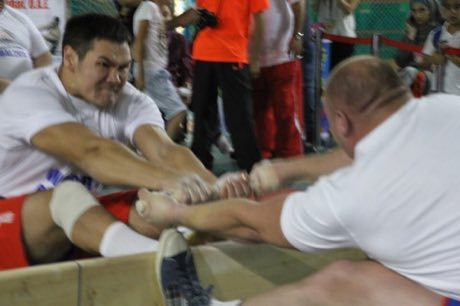

# Mas-wrestling

*Мас-тартыы · stick pull*

**Encyclopedia ID 380** (permanent) · https://equalinformation.com/world-heritage-games-site/games/380-mas-wrestling/

*Photo: Нэксэгэй, [CC BY-SA 4.0](https://creativecommons.org/licenses/by-sa/4.0/), [source on Wikimedia Commons](https://commons.wikimedia.org/wiki/File:%D0%9C%D0%B0%D1%81-%D1%80%D0%B5%D1%81%D1%82%D0%BB%D0%B8%D0%BD%D0%B3_-_%D0%A4%D0%B5%D0%B4%D0%BE%D1%80_%D0%A4%D0%B5%D0%B4%D0%BE%D1%80%D0%BE%D0%B2_%D0%B8_%D0%92%D0%B8%D0%BA%D1%82%D0%BE%D1%80_%D0%9A%D0%BE%D0%BB%D0%B8%D0%B1%D0%B0%D0%B1%D1%87%D1%83%D0%BA.JPG)*

Two seated opponents brace their feet on a board and pull one stick, trying to lift the other off the ground or wrench the stick away, best of three.

## Heritage note

Part of the living heritage of Russia.

## Origins

Usually placed in the era of River Valleys and First Cities (about 3000 to 1000 BCE), although its exact origins are uncertain, within the cultural world of Steppe and Arctic.

## Facts

- **Where:** Russia
- **Type:** Wrestling and martial sports
- **Family:** Wrestling
- **Era:** [River Valleys and First Cities](../../eras/river-valleys/index.md) (uncertain)
- **Cradle:** [Steppe and Arctic](../../cradles/steppe-arctic/index.md)
- **Region:** Europe

## Related entries

- [Bökh](../../games/374-bokh/index.md)
- [Laamb Wrestling Bout](../../games/166-laamb-wrestling-bout/index.md)
- [Kurash](../../games/253-kurash/index.md)
- [Kushti / Pehlwani mud wrestling](../../games/256-kushti-pehlwani-mud-wrestling/index.md)
- [Sumo bout](../../games/359-sumo-bout/index.md)
- [Ssireum](../../games/366-ssireum/index.md)

## Sources

- <https://commons.wikimedia.org/wiki/File:%D0%9C%D0%B0%D1%81-%D1%80%D0%B5%D1%81%D1%82%D0%BB%D0%B8%D0%BD%D0%B3_-_%D0%A4%D0%B5%D0%B4%D0%BE%D1%80_%D0%A4%D0%B5%D0%B4%D0%BE%D1%80%D0%BE%D0%B2_%D0%B8_%D0%92%D0%B8%D0%BA%D1%82%D0%BE%D1%80_%D0%9A%D0%BE%D0%BB%D0%B8%D0%B1%D0%B0%D0%B1%D1%87%D1%83%D0%BA.JPG>
