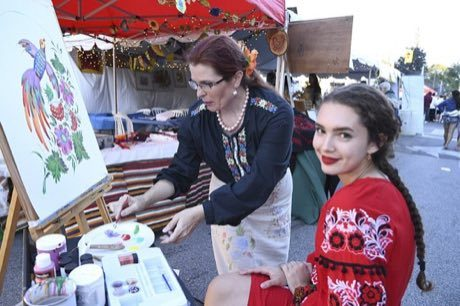

# Petrykivka painting

*Also known as: Петриківський розпис*

**Encyclopedia ID 381** (permanent) · https://bpupadhyaya.github.io/world-heritage-games-site/games/381-petrykivka-painting/

*Photo: Mykola Swarnyk, [CC BY-SA 4.0](https://creativecommons.org/licenses/by-sa/4.0/), [source on Wikimedia Commons](https://commons.wikimedia.org/wiki/File:Petrykivka_painting_workshop_at_the_BWF_2019.jpg)*

Using a finger or a fine cat-hair brush, the painter builds fantasy flowers and birds from single strokes in bright colours on a dark or light ground.

## Heritage note

Part of the living heritage of Ukraine. It is presented as sport and skill, never as real fighting.

## Origins

A living tradition passed from person to person; it is not tied to a single dated origin. It belongs to the cultural world of Northern and Eastern Europe.

## Facts

- **Where:** Ukraine
- **Type:** Crafts and making
- **Family:** Paper, ink and painting crafts
- **Era:** [Living Traditions](../../eras/living/index.md)
- **Cradle:** [Northern and Eastern Europe](../../cradles/north-east-europe/index.md)
- **Region:** Europe

## Related entries

- [Matryoshka](../../games/28-matryoshka/index.md)
- [Khokhloma Pattern Painting](../../games/102-khokhloma-pattern-painting/index.md)
- [Rosemaling](../../games/120-rosemaling/index.md)
- [Kalocsa floral painting](../../games/383-kalocsa-floral-painting/index.md)
- [Dala Horse Painting](../../games/415-dala-horse-painting/index.md)
- [Paper Soccer](../../games/464-paper-soccer/index.md)

## Sources

- <https://commons.wikimedia.org/wiki/File:Petrykivka_painting_workshop_at_the_BWF_2019.jpg>
