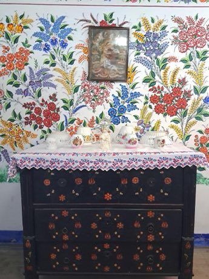

# Kalocsa floral painting

*Kalocsai virágminta*

**Encyclopedia ID 383** (permanent) · https://bpupadhyaya.github.io/world-heritage-games-site/games/383-kalocsa-floral-painting/

*Photo: Bybbisch94, Christian Gebhardt, [CC BY-SA 4.0](https://creativecommons.org/licenses/by-sa/4.0/), [source on Wikimedia Commons](https://commons.wikimedia.org/wiki/File:Folk_Art_House,_wall_painting,_20230430.Kalocsa.-027.jpg)*

The player builds flowers from stem and petal motifs in the Kalocsa style and decorates a cloth, wall or paprika-jar pattern within a symmetrical template.

## Heritage note

Part of the living heritage of Hungary.

## Origins

A living tradition passed from person to person; it is not tied to a single dated origin. It belongs to the cultural world of Northern and Eastern Europe.

## Facts

- **Where:** Hungary
- **Type:** Crafts and making
- **Family:** Paper, ink and painting crafts
- **Era:** [Living Traditions](../../eras/living/index.md)
- **Cradle:** [Northern and Eastern Europe](../../cradles/north-east-europe/index.md)
- **Region:** Europe

## Related entries

- [Matryoshka](../../games/28-matryoshka/index.md)
- [Khokhloma Pattern Painting](../../games/102-khokhloma-pattern-painting/index.md)
- [Rosemaling](../../games/120-rosemaling/index.md)
- [Petrykivka painting](../../games/381-petrykivka-painting/index.md)
- [Dala Horse Painting](../../games/415-dala-horse-painting/index.md)
- [Paper Soccer](../../games/464-paper-soccer/index.md)

## Sources

- <https://commons.wikimedia.org/wiki/File:Folk_Art_House,_wall_painting,_20230430.Kalocsa.-027.jpg>
