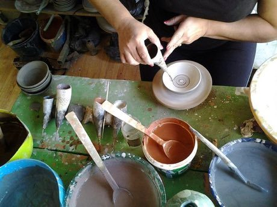

# Horezu ceramics

*Also known as: Ceramica de Horezu*

**Encyclopedia ID 384** (permanent) · https://bpupadhyaya.github.io/world-heritage-games-site/games/384-horezu-ceramics/

*Photo: Stoschmidt, [CC BY-SA 4.0](https://creativecommons.org/licenses/by-sa/4.0/), [source on Wikimedia Commons](https://commons.wikimedia.org/wiki/File:Horezu14.jpg)*

The potter paints slip designs with a horn to trace roosters, spirals and trees, then glazes the plate.

## Heritage note

Part of the living heritage of Romania. Some forms of this practice carry deep meaning for the communities who keep it; here we describe the play and the craft only, with respect for its roots.

## Origins

A living tradition passed from person to person; it is not tied to a single dated origin. It belongs to the cultural world of Northern and Eastern Europe.

## Facts

- **Where:** Romania
- **Type:** Crafts and making
- **Family:** Pottery, wood and metal crafts
- **Era:** [Living Traditions](../../eras/living/index.md)
- **Cradle:** [Northern and Eastern Europe](../../cradles/north-east-europe/index.md)
- **Region:** Europe

## Related entries

- [Marginea black pottery](../../games/5230-marginea-black-pottery/index.md)
- [Skrabalai](../../games/388-skrabalai/index.md)
- [Bolesławiec Stamped Pottery](../../games/1244-bolesawiec-stamped-pottery/index.md)
- [Bulgarian Painted Pottery](../../games/1388-bulgarian-painted-pottery/index.md)
- [Chip carving](../../games/1991-chip-carving/index.md)
- [Bohemian glass making](../../games/5269-bohemian-glass-making/index.md)

## Sources

- <https://commons.wikimedia.org/wiki/File:Horezu14.jpg>
