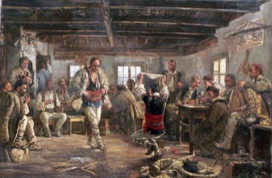

# Bulgarian asymmetric rhythm

*Also known as: Ръченица · Rachenitsa*

**Encyclopedia ID 385** (permanent) · https://bpupadhyaya.github.io/world-heritage-games-site/games/385-bulgarian-asymmetric-rhythm/

*Photo: Ivan Mrkvička, [Public domain](https://creativecommons.org/publicdomain/mark/1.0/), [source on Wikimedia Commons](https://commons.wikimedia.org/wiki/File:Ivan_Mrkvi%C4%8Dka_-_Rachenitsa.jpg)*

Bulgarian asymmetric rhythm is a dance tradition from Bulgaria.

## Heritage note

Part of the living heritage of Bulgaria.

## Origins

A living tradition passed from person to person; it is not tied to a single dated origin. It belongs to the cultural world of Northern and Eastern Europe.

## Facts

- **Where:** Bulgaria
- **Type:** Dances
- **Family:** Folk and line dances
- **Era:** [Living Traditions](../../eras/living/index.md)
- **Cradle:** [Northern and Eastern Europe](../../cradles/north-east-europe/index.md)
- **Region:** Europe

## Play it

[Web preview](https://bpupadhyaya.github.io/) · [Google Play](https://play.google.com/store/apps/details?id=com.equalinformation.arcforge.shell) · [App Store](https://apps.apple.com/us/app/arcforge-world-heritage-games/id6813746442)

## Related entries

- [Balkan Kolo](../../games/134-balkan-kolo/index.md)
- [Schuhplattler](../../games/410-schuhplattler/index.md)
- [Faroese chain dance](../../games/1276-faroese-chain-dance/index.md)
- [Dabke line dance](../../games/37-dabke-line-dance/index.md)
- [Gumboot dance rhythm](../../games/123-gumboot-dance-rhythm/index.md)
- [Tahtib](../../games/157-tahtib/index.md)

## Sources

- <https://commons.wikimedia.org/wiki/File:Ivan_Mrkvi%C4%8Dka_-_Rachenitsa.jpg>
