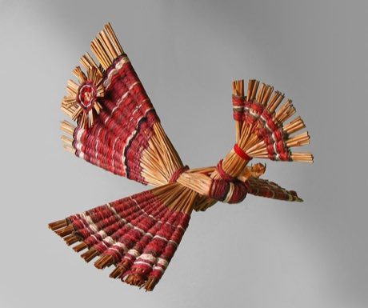

# Belarusian straw weaving

*Also known as: Салома*

**Encyclopedia ID 387** (permanent) · https://bpupadhyaya.github.io/world-heritage-games-site/games/387-belarusian-straw-weaving/

*Photo: Viktar Pałściuk, [CC BY 2.5](https://creativecommons.org/licenses/by/2.5/), [source on Wikimedia Commons](https://commons.wikimedia.org/wiki/File:Belarusian_Straw_Bird.jpg)*

Straw is folded and tied in geometric shapes into spiders, birds and stars hung as light mobiles.

## Heritage note

Part of the living heritage of Belarus.

## Origins

A living tradition passed from person to person; it is not tied to a single dated origin. It belongs to the cultural world of Northern and Eastern Europe.

## Facts

- **Where:** Belarus
- **Type:** Crafts and making
- **Family:** Textile and weaving crafts
- **Era:** [Living Traditions](../../eras/living/index.md)
- **Cradle:** [Northern and Eastern Europe](../../cradles/north-east-europe/index.md)
- **Region:** Europe

## Related entries

- [Slutsk Sash Weaving](../../games/1375-slutsk-sash-weaving/index.md)
- [Cross-Stitch Pattern Weaving](../../games/103-cross-stitch-pattern-weaving/index.md)
- [Haapsalu lace shawl knitting](../../games/386-haapsalu-lace-shawl-knitting/index.md)
- [Hardanger embroidery](../../games/1296-hardanger-embroidery/index.md)
- [Lielvārde Sash Pattern Weaving](../../games/1327-lielvarde-sash-pattern-weaving/index.md)
- [Moldovan Woven Carpet Pattern Studio](../../games/1339-moldovan-woven-carpet-pattern-studio/index.md)

## Sources

- <https://commons.wikimedia.org/wiki/File:Belarusian_Straw_Bird.jpg>
