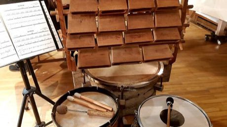

# Skrabalai

*Skrabalai · Lithuanian wooden cowbells*

**Encyclopedia ID 388** (permanent) · https://bpupadhyaya.github.io/world-heritage-games-site/games/388-skrabalai/

*Photo: Imodab, [CC BY-SA 4.0](https://creativecommons.org/licenses/by-sa/4.0/), [source on Wikimedia Commons](https://commons.wikimedia.org/wiki/File:Skrabalai,_tautiniai_b%C5%ABgnai.jpg)*

A set of tuned wooden boxes with clappers is shaken or struck in a pattern, rolled into a ring of drums.

## Heritage note

Part of the living heritage of Lithuania.

## Origins

A living tradition passed from person to person; it is not tied to a single dated origin. It belongs to the cultural world of Northern and Eastern Europe.

## Facts

- **Where:** Lithuania
- **Type:** Musical instruments
- **Family:** Pottery, wood and metal crafts
- **Era:** [Living Traditions](../../eras/living/index.md)
- **Cradle:** [Northern and Eastern Europe](../../cradles/north-east-europe/index.md)
- **Region:** Europe

## Related entries

- [Horezu ceramics](../../games/384-horezu-ceramics/index.md)
- [Bolesławiec Stamped Pottery](../../games/1244-bolesawiec-stamped-pottery/index.md)
- [Bulgarian Painted Pottery](../../games/1388-bulgarian-painted-pottery/index.md)
- [Zellij tile mosaic](../../games/21-zellij-tile-mosaic/index.md)
- [Swahili carved door](../../games/90-swahili-carved-door/index.md)
- [Thai fruit and vegetable carving](../../games/114-thai-fruit-and-vegetable-carving/index.md)

## Sources

- <https://commons.wikimedia.org/wiki/File:Skrabalai,_tautiniai_b%C5%ABgnai.jpg>
