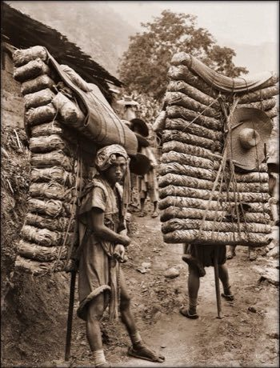

# Tea Horse Road Caravan

*Chamadao*

**Encyclopedia ID 39** (permanent) · https://bpupadhyaya.github.io/world-heritage-games-site/games/39-tea-horse-road-caravan/

*Photo: ralph repo, [CC BY 2.0](https://creativecommons.org/licenses/by/2.0/), [source on Wikimedia Commons](https://commons.wikimedia.org/wiki/File:Men_Laden_With_Tea,_Sichuan_Sheng,_China_1908_Ernest_H._Wilson_RESTORED.jpg)*

Lead a porter and mule caravan from tea terraces to high markets, choosing routes, rest stops and loads against weather, terrain and prices.

## Heritage note

Part of the living heritage of China. Some forms of this practice carry deep meaning for the communities who keep it; here we describe the play and the craft only, with respect for its roots. Animals are partners in this tradition; good care and local rules always come first.

## Origins

Usually placed in the era of Classical Worlds (about 1000 BCE to 500 CE), although its exact origins are uncertain, within the cultural world of China.

## Facts

- **Where:** China
- **Type:** Board and table games
- **Era:** [Classical Worlds](../../eras/classical/index.md) (uncertain)
- **Cradle:** [China](../../cradles/china/index.md)
- **Region:** East and Southeast Asia

## Related entries

- [Dizi](../../games/132-dizi/index.md)
- [Cuju](../../games/333-cuju/index.md)
- [Dougong Bracket Stacking](../../games/504-dougong-bracket-stacking/index.md)
- [Go](../../games/634-go/index.md)
- [Pitch-pot](../../games/2-pitch-pot/index.md)
- [Chinese knotting](../../games/26-chinese-knotting/index.md)

## Sources

- <https://commons.wikimedia.org/wiki/File:Men_Laden_With_Tea,_Sichuan_Sheng,_China_1908_Ernest_H._Wilson_RESTORED.jpg>
