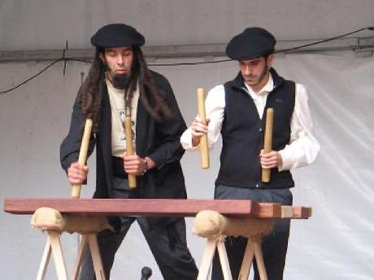

# Txalaparta Duet

*Also known as: Txalaparta*

**Encyclopedia ID 390** (permanent) · https://bpupadhyaya.github.io/world-heritage-games-site/games/390-txalaparta-duet/

*Photo: Iñaki LL, [Public domain](https://creativecommons.org/publicdomain/mark/1.0/), [source on Wikimedia Commons](https://commons.wikimedia.org/wiki/File:Two_txalaparta_players_at_a_performance_in_a_fiesta.jpg)*

Two players strike long wooden planks with batons in an alternating call-and-answer pattern, each filling the gap the partner leaves.

## Heritage note

Part of the living heritage of Spain.

## Origins

A living tradition passed from person to person; it is not tied to a single dated origin. It belongs to the cultural world of Mediterranean.

## Facts

- **Where:** Spain
- **Type:** Musical instruments
- **Family:** Pottery, wood and metal crafts
- **Era:** [Living Traditions](../../eras/living/index.md)
- **Cradle:** [Mediterranean](../../cradles/mediterranean/index.md)
- **Region:** Europe

## Related entries

- [Zellij tile mosaic](../../games/21-zellij-tile-mosaic/index.md)
- [Glassblowing](../../games/121-glassblowing/index.md)
- [Azulejo tile painting](../../games/122-azulejo-tile-painting/index.md)
- [Tessellated Mosaic Making](../../games/500-tessellated-mosaic-making/index.md)
- [Albanian filigree](../../games/5102-albanian-filigree/index.md)
- [Kabyle Enamel Jewellery](../../games/6086-kabyle-enamel-jewellery/index.md)

## Sources

- <https://commons.wikimedia.org/wiki/File:Two_txalaparta_players_at_a_performance_in_a_fiesta.jpg>
