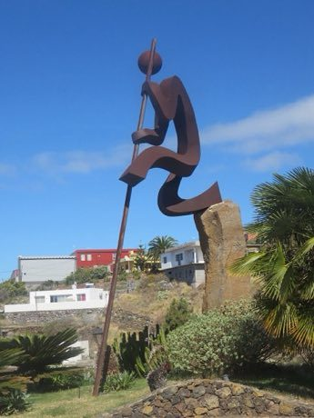

# Shepherd's Leap

*Also known as: Salto del pastor*

**Encyclopedia ID 391** (permanent) · https://bpupadhyaya.github.io/world-heritage-games-site/games/391-shepherds-leap/

*Photo: arinaga, [Public domain](https://creativecommons.org/publicdomain/mark/1.0/), [source on Wikimedia Commons](https://commons.wikimedia.org/wiki/File:Salto_del_Pastor_04.jpg)*

Plant a long iron-tipped pole and swing or vault across ravines, up walls and down rock faces, scored for distance, precision of landing and clean descent.

## Heritage note

A tradition shared by communities in many places. Some forms of this practice carry deep meaning for the communities who keep it; here we describe the play and the craft only, with respect for its roots.

## Origins

Usually placed in the era of Modern Heritage (1800 to today), although its exact origins are uncertain.

## Facts

- **Where:** Shared across many places
- **Type:** Puzzles and mind games
- **Family:** Puzzle and dexterity toys
- **Era:** [Modern Heritage](../../eras/modern/index.md) (uncertain)
- **Cradle:** [Shared across the world](../../cradles/worldwide/index.md)
- **Region:** Europe

## Related entries

- [Kingyo-sukui](../../games/3-kingyo-sukui/index.md)
- [Disc-flip](../../games/8-disc-flip/index.md)
- [Sjoelen](../../games/9-sjoelen/index.md)
- [Shove ha'penny](../../games/54-shove-hapenny/index.md)
- [Limbo](../../games/58-limbo/index.md)
- [Daruma Otoshi](../../games/63-daruma-otoshi/index.md)

## Sources

- <https://commons.wikimedia.org/wiki/File:Salto_del_Pastor_04.jpg>
