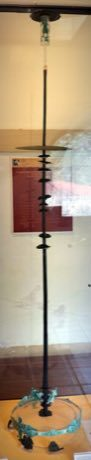

# Kottabos Symposium Toss

*Also known as: Kottabos (κότταβος)*

**Encyclopedia ID 392** (permanent) · https://bpupadhyaya.github.io/world-heritage-games-site/games/392-kottabos-symposium-toss/

*Photo: Bryn Mawr Painter, photo via Wikimedia Commons, [CC BY-SA 3.0](https://creativecommons.org/licenses/by-sa/3.0/), [source on Wikimedia Commons](https://commons.wikimedia.org/wiki/File:Attic_Red-Figure_Plate.jpg)*

Reclining with a cup hooked on one finger, flick the last drops with a wrist snap to knock a balanced disc off a bronze stand or sink floating bowls.

## Heritage note

Part of the living heritage of Greece.

## Origins

Usually placed in the era of Classical Worlds (about 1000 BCE to 500 CE), although its exact origins are uncertain, within the cultural world of Mediterranean.

## Facts

- **Where:** Greece
- **Type:** Archery, throwing and target games
- **Family:** Winter sports
- **Era:** [Classical Worlds](../../eras/classical/index.md) (uncertain)
- **Cradle:** [Mediterranean](../../cradles/mediterranean/index.md)
- **Region:** Europe

## Related entries

- [Malha](../../games/1466-malha/index.md)
- [Barrel racing](../../games/439-barrel-racing/index.md)
- [Skijoring](../../games/490-skijoring/index.md)
- [Ring Tilting](../../games/65-ring-tilting/index.md)
- [Gondola Rowing](../../games/401-gondola-rowing/index.md)
- [Crossbow Target Match](../../games/1367-crossbow-target-match/index.md)

## Sources

- <https://commons.wikimedia.org/wiki/File:Attic_Red-Figure_Plate.jpg>
