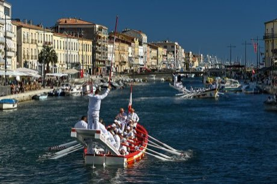

# Water Jousting

*Also known as: Joutes nautiques (Sète tradition)*

**Encyclopedia ID 393** (permanent) · https://bpupadhyaya.github.io/world-heritage-games-site/games/393-water-jousting/

*Photo: Jorge Franganillo, [CC BY 2.0](https://creativecommons.org/licenses/by/2.0/), [source on Wikimedia Commons](https://commons.wikimedia.org/wiki/File:S%C3%A8te_water_jousting_joute_nautique_(52222049980).jpg)*

Two boats row at each other; each jouster on a high stern platform tries to knock the opponent into the canal with a blunt lance while shielding.

## Heritage note

Part of the living heritage of France.

## Origins

Usually placed in the era of Crossroads and Golden Ages (about 500 to 1500), although its exact origins are uncertain, within the cultural world of Celtic and Atlantic Europe.

## Facts

- **Where:** France
- **Type:** Wrestling and martial sports
- **Era:** [Crossroads and Golden Ages](../../eras/crossroads/index.md) (uncertain)
- **Cradle:** [Celtic and Atlantic Europe](../../cradles/celtic-atlantic/index.md)
- **Region:** Europe

## Related entries

- [Croquet](../../games/81-croquet/index.md)
- [Racing Pigeon Loft](../../games/411-racing-pigeon-loft/index.md)
- [Highland Bagpipe Chanter and Drone](../../games/510-highland-bagpipe-chanter-and-drone/index.md)
- [Hurling](../../games/821-hurling/index.md)
- [Dutch draughts](../../games/970-dutch-draughts/index.md)
- [Pub dominoes](../../games/1183-pub-dominoes/index.md)

## Sources

- <https://commons.wikimedia.org/wiki/File:S%C3%A8te_water_jousting_joute_nautique_(52222049980).jpg>
